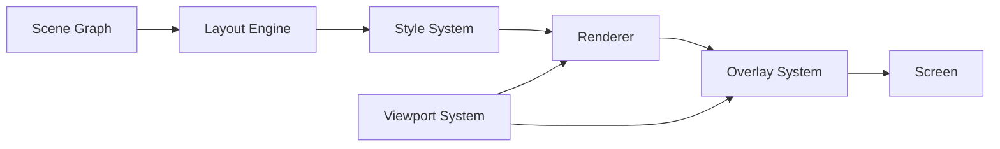
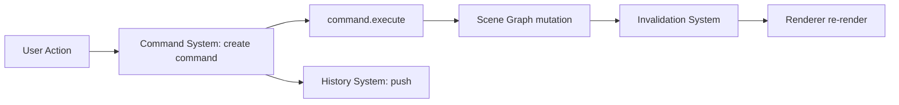
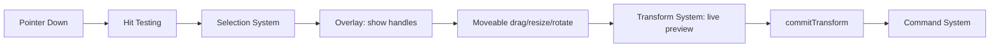

# ARCHITECTURE.md
### Enterprise Visual Editor Engine — Engineering Blueprint (v1)

> Companion document to the Codex/Claude project-memory prompt.
> Memory prompt = rules of engagement. This document = the actual blueprint those rules are enforcing.
>
> This is v1: a working, usable architecture spec covering the Core/Rendering/Interaction/Layout foundations in full depth, plus a complete index of every remaining system so nothing gets lost. Deep-dive docs for the remaining systems (`docs/SYSTEMS/*.md`) should be generated **on demand, one system at a time, right before that system is implemented** — using the template in Section 12. Writing all 50 up front produces documentation that's stale before the code exists.

---

## 1. Purpose of This Document

This is the engineering contract for the editor. Every system described here has:

- A single, non-overlapping **responsibility**
- A declared **owned state**
- A declared **public API surface**
- Explicit **dependencies** (what it's allowed to talk to)
- Explicit **non-goals** (what it must never absorb)

If a change doesn't fit cleanly into one system's responsibility, that's a signal to stop and reconsider — not to stretch the system.

---

## 2. Product Vision

An engine-first, modular visual editor (Canva/Figma/Framer-class), where:

- Elements (Text, Image, Button, Shape, etc.) are **thin modules** that consume shared systems.
- No element ever re-implements selection, transform, history, or rendering logic.
- The engine can scale to thousands of nodes without architectural rewrites.
- Systems are replaceable in isolation (e.g. swapping the transform library later shouldn't touch Selection or History).

---

## 3. Non-Negotiable Principles

1. **Engine first, features second.** Elements consume systems; they never own logic that belongs to a system.
2. **Single ownership of state.** Every piece of state has exactly one system/store that may write to it. Everyone else reads.
3. **Commands, not snapshots.** All mutations go through the Command System so History stays cheap and undo/redo stays correct.
4. **No silent scope creep.** Selection ≠ Transform. Renderer ≠ Hit Testing. Layout ≠ Constraints. Property ≠ Style. These are common failure points in GrapesJS/Fabric-style editors — keep them separate even when it's tempting to merge "just this once."
5. **Composition over inheritance.** Element modules are composed from systems via hooks/adapters, not class hierarchies.
6. **Preserve existing code.** Refactor into this shape incrementally; don't rewrite from zero.

---

## 4. Tech Stack (Final)

| Category | Choice |
|---|---|
| Framework | React 18 + TypeScript |
| Build | Vite |
| Styling | Tailwind CSS + Shadcn UI + Radix UI |
| State | Zustand (multi-store) + Immer |
| Validation | Zod |
| Drag & Drop (UI/layers/sidebar) | dnd-kit |
| Transform (resize/rotate/scale/warp) | react-moveable |
| Multi-selection (marquee/drag-select) | react-selecto |
| Persistence / Offline / Autosave | Dexie (IndexedDB) |
| Animation (UI chrome, not element animation system) | Motion (Framer Motion) |
| Data fetching / async | React Query |
| Icons | Lucide |

Explicitly **not** used: Redux, MobX, Konva-as-renderer, Fabric.js, Craft.js, GrapesJS. The custom engine replaces what those libraries would otherwise provide.

---

## 5. High-Level Layer Architecture

```
Editor Engine
│
├── Core Engine Layer        (kernel, event bus, scene graph, commands, history)
├── Rendering Layer          (renderer, canvas, viewport, overlay, hit testing)
├── Interaction Layer        (selection, transform, tools, input, drag & drop)
├── Layout Layer             (layout engine, constraints, responsive, grid, style)
├── Document Layer           (layers, components, variables, properties, inspector)
├── Asset Layer              (images, svg, video, fonts, icons, palettes, templates)
├── Persistence Layer        (clipboard, import/export, save/load, autosave, versioning)
├── Infrastructure Layer     (performance, logging, diagnostics, config, feature flags)
├── Extension Layer          (plugins, custom registries, future SDK)
└── Element Modules          (Text, Image, Button, Container, Section, Shape, SVG,
                              Video, Custom — thin consumers of every layer above)
```

**Dependency direction rule:** lower layers never import from higher layers. Element Modules may depend on any system. The Core Engine Layer depends on nothing above it.

```
Core → Rendering → Interaction → Layout → Document → Asset → Persistence → Infrastructure → Extension → Elements
(each layer may depend on layers to its left; never to its right)
```

---

## 6. Repository / Folder Structure

```
src/
├── engine/
│   ├── kernel/                  # bootstraps engine, wires systems together
│   ├── event-bus/
│   ├── scene-graph/
│   ├── node-lifecycle/
│   ├── dependency-graph/
│   ├── command/
│   ├── history/
│   ├── validation/
│   ├── serialization/
│   └── invalidation/
│
├── rendering/
│   ├── renderer/
│   ├── canvas/
│   ├── viewport/
│   ├── geometry/
│   ├── coordinate/
│   ├── registry/
│   ├── visibility/
│   ├── hit-testing/
│   └── overlay/
│
├── interaction/
│   ├── selection/
│   ├── transform/
│   ├── snap/
│   ├── drag-drop/
│   ├── input/                   # keyboard + pointer/event system merged
│   ├── cursor/
│   ├── focus/
│   ├── tools/
│   └── modes/
│
├── layout/
│   ├── layout-engine/
│   ├── constraints/
│   ├── responsive/
│   ├── grid/
│   ├── auto-layout/
│   ├── alignment/
│   └── style/
│
├── document/
│   ├── layers/
│   ├── components/
│   ├── variables/
│   ├── properties/
│   ├── inspector/
│   └── animation/
│
├── assets/
│   ├── images/
│   ├── svg/
│   ├── video/
│   ├── fonts/
│   ├── icons/
│   ├── palettes/
│   └── templates/
│
├── persistence/
│   ├── clipboard/
│   ├── import-export/
│   ├── project-save-load/
│   ├── autosave/                # Dexie-backed
│   ├── preferences/
│   └── recovery/
│
├── infrastructure/
│   ├── performance/
│   ├── logger/
│   ├── diagnostics/
│   ├── feature-flags/
│   └── config/
│
├── extension/
│   ├── plugin-system/
│   └── registries/               # elements, properties, tools
│
├── elements/
│   ├── text/
│   ├── image/
│   ├── button/
│   ├── container/
│   ├── section/
│   ├── shape/
│   ├── svg/
│   ├── video/
│   └── custom/
│
├── stores/                       # thin zustand stores, one file per store
│   ├── scene.store.ts
│   ├── canvas.store.ts
│   ├── selection.store.ts
│   ├── viewport.store.ts
│   ├── history.store.ts
│   ├── inspector.store.ts
│   ├── tool.store.ts
│   ├── clipboard.store.ts
│   ├── asset.store.ts
│   └── preferences.store.ts
│
└── ui/                            # React components: panels, toolbar, sidebar
    ├── sidebar/
    ├── inspector-panel/
    ├── toolbar/
    └── canvas-shell/

docs/
├── ARCHITECTURE.md               # this file
├── ENGINE.md
├── SYSTEMS/                       # generated one-at-a-time, on demand
├── FLOWS/
├── API/
└── ROADMAP.md
```

Rule of thumb: **one system = one folder**, and a folder never reaches into another system's internals — only its exported public API (`index.ts`).

---

## 7. State Management Architecture

### 7.1 Store list and exclusive ownership

| Store | Owns | May be written by |
|---|---|---|
| `scene.store` | Scene graph nodes, tree structure | Command System only |
| `canvas.store` | Canvas dimensions, background, grid, rulers, guides, safe areas | Canvas System only |
| `selection.store` | Selected IDs, hovered ID | Selection System only |
| `viewport.store` | Zoom, pan offset, camera bounds | Viewport System only |
| `history.store` | Undo/redo stack pointers | History System only |
| `inspector.store` | Active inspector tab/UI state (not node data) | Inspector System only |
| `tool.store` | Active tool, tool options | Tool System only |
| `clipboard.store` | Copied node snapshot(s) | Clipboard System only |
| `asset.store` | Asset library cache/index | Asset System only |
| `preferences.store` | User/editor preferences | Preferences System only |

**Rule:** No React component ever calls `set()` on a store directly for document data. Components dispatch a **Command**; the Command System is the only thing allowed to mutate `scene.store`. This is what makes undo/redo reliable.

### 7.2 Why multiple stores instead of one global store

- Prevents unrelated re-renders (dragging the viewport shouldn't re-render the inspector).
- Makes ownership violations visible in code review (`inspector.store.setState` appearing inside `transform/` is an immediate red flag).
- Each store can independently opt into Immer's `produce` for structural sharing.

---

## 8. Core Data Model

```ts
// engine/scene-graph/types.ts

type NodeId = string;

interface SceneNode {
  id: NodeId;
  type: ElementType;             // 'text' | 'image' | 'button' | 'container' |
                                  // 'section' | 'shape' | 'svg' | 'video' | `custom:${string}`
  parentId: NodeId | null;
  childIds: NodeId[];

  transform: TransformData;
  layout: LayoutData;
  style: StyleData;

  props: Record<string, unknown>; // element-specific payload (e.g. text content)
  meta: NodeMeta;
}

interface TransformData {
  x: number;
  y: number;
  width: number;
  height: number;
  rotation: number;
  scaleX: number;
  scaleY: number;
  skewX: number;
  skewY: number;
  transformOrigin: [number, number];
  zIndex: number;
}

interface LayoutData {
  mode: 'absolute' | 'flex' | 'grid';
  constraints?: ConstraintData;
  autoLayout?: AutoLayoutData;
}

interface StyleData {
  fills: Fill[];
  strokes: Stroke[];
  effects: Effect[];
  opacity: number;
  cornerRadius?: number | CornerRadiusPerCorner;
}

interface NodeMeta {
  name: string;
  locked: boolean;
  hidden: boolean;
  componentId?: string;   // if instance of a Component
  createdAt: number;
  updatedAt: number;
}
```

This schema is the contract every system reads/writes against. Element modules never invent parallel shadow state — element-specific data lives in `node.props`, typed per element via the Custom Element Registry.

---

## 9. Core System Specifications

Each entry: **Purpose → Owns → Does NOT own → Public API → Depends on → Folder → Notes.**

### 9.1 Scene Graph System
- **Purpose:** Single source of truth for the document tree.
- **Owns:** Node records, parent/child relationships, node ordering (z-order within parent).
- **Does NOT own:** Selection state, transform math, rendering.
- **Public API:**
```ts
interface SceneGraphAPI {
  getNode(id: NodeId): SceneNode | undefined;
  getChildren(id: NodeId): SceneNode[];
  getPath(id: NodeId): NodeId[];        // root → node
  addNode(node: SceneNode, parentId: NodeId, index?: number): void;
  removeNode(id: NodeId): void;
  reparent(id: NodeId, newParentId: NodeId, index?: number): void;
  traverse(visitor: (node: SceneNode) => void): void;
}
```
- **Depends on:** Node Lifecycle System, Dependency Graph System.
- **Folder:** `engine/scene-graph/`
- **Notes:** All mutations here happen *inside* Command `execute()`/`undo()` bodies — never called ad hoc from UI code.

### 9.2 Node Lifecycle System
- **Purpose:** Governs creation, mounting, unmounting, destruction hooks for nodes.
- **Owns:** Lifecycle hook registry (`onCreate`, `onMount`, `onDestroy` per element type).
- **Does NOT own:** The node data itself (Scene Graph owns that).
- **Public API:** `registerLifecycle(type, hooks)`, `runCreate(node)`, `runDestroy(node)`.
- **Depends on:** Custom Element Registry.
- **Folder:** `engine/node-lifecycle/`

### 9.3 Command System
- **Purpose:** The only sanctioned path for mutating the Scene Graph.
- **Owns:** Command registry/factory functions.
- **Does NOT own:** Undo/redo stacks (History System owns those).
- **Public API:**
```ts
interface Command<T = unknown> {
  id: string;
  type: string;
  timestamp: number;
  payload: T;
  execute(ctx: EngineContext): void;
  undo(ctx: EngineContext): void;
  redo?(ctx: EngineContext): void;
  merge?(next: Command): Command | null; // coalesce e.g. drag-move ticks
}

interface CommandSystemAPI {
  dispatch<T>(command: Command<T>): void;
  createMoveCommand(ids: NodeId[], delta: {x:number;y:number}): Command;
  createResizeCommand(id: NodeId, next: Partial<TransformData>): Command;
  createDeleteCommand(ids: NodeId[]): Command;
  // ...one factory per mutation type
}
```
- **Depends on:** Scene Graph System, History System.
- **Folder:** `engine/command/`
- **Notes:** `merge()` is critical for performance — a drag gesture should coalesce into one history entry, not one per pointer-move tick.

### 9.4 History System
- **Purpose:** Undo/redo stack management.
- **Owns:** Ordered list of executed commands + current pointer.
- **Does NOT own:** Full document snapshots. Never store full state copies — only commands.
- **Public API:** `undo()`, `redo()`, `canUndo()`, `canRedo()`, `clear()`.
- **Depends on:** Command System.
- **Folder:** `engine/history/`

### 9.5 Viewport System ⭐ (new — was missing from original list)
- **Purpose:** Owns the camera — what part of the infinite canvas is visible and at what zoom.
- **Owns:** Zoom level, pan offset, visible region bounds, minimap camera rect.
- **Does NOT own:** Node positions (those are in document space, not screen space).
- **Public API:**
```ts
interface ViewportAPI {
  zoomTo(level: number, origin?: Point): void;
  panBy(delta: Point): void;
  panTo(point: Point): void;
  getVisibleRegion(): Rect;                 // in document space
  screenToDocument(p: Point): Point;
  documentToScreen(p: Point): Point;
  fitToContent(nodeIds?: NodeId[]): void;
}
```
- **Depends on:** Coordinate System.
- **Folder:** `rendering/viewport/`
- **Notes:** Every coordinate conversion in the app (hit testing, overlay placement, drag math) must route through this system's conversion functions — never hand-roll `zoom * x + pan` math in a component.

### 9.6 Canvas System ⭐ (new — distinct from Renderer)
- **Purpose:** Owns the workspace surface itself, independent of what's drawn on it.
- **Owns:** Canvas dimensions, background, grid, rulers, guides, safe areas, margins.
- **Does NOT own:** Node rendering (Renderer System owns that), camera state (Viewport owns that).
- **Public API:** `setCanvasSize()`, `toggleGrid()`, `addGuide()`, `getSafeArea()`.
- **Depends on:** Viewport System.
- **Folder:** `rendering/canvas/`

### 9.7 Renderer System
- **Purpose:** Draws Scene Graph nodes to the screen.
- **Owns:** The render tree / draw calls, DOM (or canvas2d/WebGL) reconciliation for nodes.
- **Does NOT own:** Hit testing, overlays, selection visuals.
- **Public API:** `renderNode(node)`, `invalidate(nodeId)`, `flush()`.
- **Depends on:** Scene Graph, Viewport, Style System.
- **Folder:** `rendering/renderer/`
- **Notes:** Keep Hit Testing **out** of this system even though it's tempting — this is one of the most common architectural mistakes in DIY editors.

### 9.8 Hit Testing System
- **Purpose:** Determines which node is under a given point/region.
- **Owns:** Spatial index (e.g. R-tree/quadtree) for fast lookups.
- **Does NOT own:** Rendering, selection state.
- **Public API:** `hitTest(point): NodeId | null`, `hitTestRegion(rect): NodeId[]`.
- **Depends on:** Geometry System, Coordinate System.
- **Folder:** `rendering/hit-testing/`

### 9.9 Overlay System
- **Purpose:** Renders non-content visuals — selection boxes, transform handles, snap guides, hover outlines.
- **Owns:** Overlay layer DOM/SVG, handle positions.
- **Does NOT own:** Actual transform math (Transform System owns that; Overlay just displays state).
- **Public API:** `showSelectionBox(ids)`, `showSnapGuides(guides)`, `clear()`.
- **Depends on:** Selection System, Transform System, Viewport System.
- **Folder:** `rendering/overlay/`
- **Notes:** This is the system that fixes the "selection box doesn't match Canva" problem — handle styling, padding, and hit areas live here, driven by Moveable.

### 9.10 Selection System
- **Purpose:** Tracks what's currently selected/hovered.
- **Owns:** `selectedIds`, `hoveredId`, selection order.
- **Does NOT own:** Transform math, resize/rotate behavior.
- **Public API:** `select(ids)`, `addToSelection(id)`, `clearSelection()`, `getSelectionBounds()`.
- **Depends on:** Hit Testing System, Scene Graph.
- **Folder:** `interaction/selection/`
- **Integration:** react-selecto drives marquee/shift/ctrl selection gestures; this system is the state target it writes into.

### 9.11 Transform System
- **Purpose:** Move/resize/rotate/scale/warp of selected nodes.
- **Owns:** Active transform session (in-progress drag state).
- **Does NOT own:** Selection membership.
- **Public API:** `beginTransform(ids)`, `updateTransform(delta)`, `commitTransform()` (which dispatches a Command), `cancelTransform()`.
- **Depends on:** Selection System, Snap Engine, Command System.
- **Folder:** `interaction/transform/`
- **Integration:** Wraps `react-moveable`. Moveable's live drag events update a local/uncommitted transform preview; only `commitTransform()` creates a Command (so History isn't spammed per pixel).

### 9.12 Snap Engine
- **Purpose:** Computes alignment guides/snap points during transform.
- **Owns:** Snap threshold config, active guide lines.
- **Public API:** `computeSnap(nodeBounds, siblingBounds[])`.
- **Depends on:** Geometry System.
- **Folder:** `interaction/snap/`

### 9.13 Layout Engine
- **Purpose:** Computes final positions/sizes when auto-layout/constraints/grid apply.
- **Owns:** Layout computation pass, resolved layout results (cached per node).
- **Does NOT own:** Raw transform data (absolute-mode nodes bypass this).
- **Public API:** `computeLayout(nodeId)`, `invalidateLayout(nodeId)`.
- **Depends on:** Constraint System, Responsive System, Grid System.
- **Folder:** `layout/layout-engine/`

### 9.14 Style System
- **Purpose:** Resolves visual style (fills, strokes, effects, opacity) for a node, including cascading/variables.
- **Owns:** Style resolution cache.
- **Does NOT own:** Property editing UI (Inspector System owns that), layout.
- **Public API:** `resolveStyle(node): ResolvedStyle`.
- **Depends on:** Variable System.
- **Folder:** `layout/style/`

### 9.15 Property / Inspector System
- **Purpose:** Property System = the typed schema of editable fields per element type. Inspector System = the UI binding layer that reads/writes properties.
- **Owns:** Property schemas per element type; Inspector UI active-panel state.
- **Does NOT own:** The underlying node value itself (Scene Graph owns the value; Inspector dispatches Commands to change it).
- **Public API:** `getPropertySchema(type)`, `setProperty(nodeId, key, value)` → dispatches a Command.
- **Depends on:** Command System, Custom Property Registry.
- **Folder:** `document/properties/`, `document/inspector/`

### 9.16 Asset System
- **Purpose:** Central registry/cache for images, SVGs, video, fonts, icons, palettes, templates.
- **Owns:** Asset metadata index, upload pipeline hooks.
- **Public API:** `uploadAsset(file)`, `getAsset(id)`, `listAssets(type)`.
- **Depends on:** Asset Plugin System (for external providers: Lucide, Heroicons, Google Fonts, etc.).
- **Folder:** `assets/`

### 9.17 Persistence / Autosave System
- **Purpose:** Serialize document state, autosave to IndexedDB via Dexie, crash recovery.
- **Owns:** Save cadence, draft snapshots, recovery detection on boot.
- **Does NOT own:** Live document state (reads from Scene Graph via Serialization System).
- **Public API:** `saveNow()`, `getLastDraft()`, `restoreDraft(id)`.
- **Depends on:** Serialization System, Dexie.
- **Folder:** `persistence/autosave/`

---

## 10. Full System Index

Legend — Layer tags map to Section 5. Status is intentionally left blank; fill in during the Architecture Audit phase of the roadmap (Section 13) as each system is confirmed present/partial/missing in the existing 6–7k LOC codebase.

| # | System | Layer | Status |
|---|---|---|---|
| 1 | Engine Kernel | Core | |
| 2 | Engine Event Bus | Core | |
| 3 | Scene Graph System | Core | |
| 4 | Node Lifecycle System | Core | |
| 5 | Dependency Graph System | Core | |
| 6 | Command System | Core | |
| 7 | History System | Core | |
| 8 | Computation / Invalidation System | Core | |
| 9 | Validation System | Core | |
| 10 | Serialization System | Core | |
| 11 | Renderer System | Rendering | |
| 12 | Canvas System | Rendering | |
| 13 | Viewport System | Rendering | |
| 14 | Geometry System | Rendering | |
| 15 | Coordinate System | Rendering | |
| 16 | Hit Testing System | Rendering | |
| 17 | Overlay System | Rendering | |
| 18 | Performance System | Rendering | |
| 19 | Visibility / Culling System | Rendering | |
| 20 | Selection System | Interaction | |
| 21 | Transform System | Interaction | |
| 22 | Snap Engine | Interaction | |
| 23 | Drag & Drop System | Interaction | |
| 24 | Input System (Keyboard + Event) | Interaction | |
| 25 | Cursor Manager | Interaction | |
| 26 | Focus Manager | Interaction | |
| 27 | Tool System | Interaction | |
| 28 | Mode System | Interaction | |
| 29 | Layout Engine | Layout | |
| 30 | Constraint System | Layout | |
| 31 | Responsive System | Layout | |
| 32 | Grid System | Layout | |
| 33 | Auto Layout System | Layout | |
| 34 | Alignment System | Layout | |
| 35 | Style System | Layout | |
| 36 | Layer System | Document | |
| 37 | Component System | Document | Implemented (Phase 5) |
| 38 | Variable System | Document | |
| 39 | Property System | Document | |
| 40 | Inspector System | Document | |
| 41 | Animation / Timeline System | Document | |
| 42 | Asset System (Image/SVG/Video/Font/Icon/Palette/Template managers) | Asset | |
| 43 | Asset Plugin System | Asset | |
| 44 | Clipboard System | Persistence | |
| 45 | Import / Export System | Persistence | |
| 46 | Project Save / Load System | Persistence | |
| 47 | Auto Save System | Persistence | |
| 48 | Version Manager | Persistence | |
| 49 | Preferences System | Persistence | |
| 50 | Recovery System | Persistence | |
| 51 | Error Boundary System | Infrastructure | |
| 52 | Logger / Diagnostics / Debug System | Infrastructure | |
| 53 | Feature Flags / Config System | Infrastructure | |
| 54 | Memory Monitor | Infrastructure | |
| 55 | Plugin System | Extension | |
| 56 | Custom Element / Property / Tool Registries | Extension | |
| 57 | Collaboration Layer | Extension (future) | |

---

## 11. Event & Data Flow

### 11.1 Render flow


### 11.2 Command / History flow


### 11.3 Selection → Transform flow


---

## 12. Template for Per-System Deep-Dive Docs (`docs/SYSTEMS/<name>.md`)

Use this exact structure when generating a system doc later — keeps every doc navigable the same way:

```md
# <System Name>

## Purpose
One or two sentences.

## Owns
- ...

## Does NOT Own
- ...

## Public API
```ts
// interface sketch
```

## Depends On
- ...

## Folder
`path/to/system/`

## State Ownership
Which store(s), if any, this system exclusively writes to.

## Event Flow
How this system fits into the flows in ARCHITECTURE.md §11 (link/describe).

## Performance Notes
Anything specific to this system's hot paths.

## Known Pitfalls / Anti-Patterns
Common mistakes to avoid (e.g. "don't let this absorb X responsibility").

## Extensibility
How plugins/custom types hook into this system, if applicable.
```

---

## 13. Migration Roadmap (Existing Codebase → This Architecture)

1. **Architecture Audit** — map current 6–7k LOC against the System Index (Section 10); fill in the Status column.
2. **Folder Restructure** — move code into the `engine/`, `rendering/`, `interaction/`, etc. layout without behavior changes.
3. **State Refactor** — split the current store(s) into the store list in Section 7, introduce Immer.
4. **Selection & Transform** — integrate `react-moveable` + `react-selecto`, retire any ad hoc drag/resize code.
5. **Command + History Engine** — route all mutations through Command System; remove direct store writes from UI.
6. **Viewport + Canvas** — extract camera/zoom/pan and canvas-surface concerns into their own systems.
7. **Inspector + Property Engine** — bind Inspector UI to the Property System via Commands.
8. **Performance Pass** — memoization, culling, invalidation batching.
9. **Asset Manager** — consolidate image/svg/font/icon handling behind the Asset System.
10. **Advanced Features** — Components, Variables, Responsive, Animation, Collaboration groundwork.

Each phase should preserve a working, shippable app — this is a strangler-fig migration, not a rewrite.

---

## 14. Coding Standards (Reference)

- Components < 300 lines, hooks < 200 lines, utilities < 250 lines.
- One system = one folder; cross-system access only via `index.ts` public exports.
- No direct store mutation for document data outside the Command System.
- No new dependency without a named architectural problem it solves.
- A Zustand store exists only for state React components subscribe to for rendering. Internal-only caches, indexes, registries, and service state stay inside systems behind imperative APIs.
- Every new system gets a `docs/SYSTEMS/<name>.md` before or immediately after implementation — not "later."

---

## 15. Document Status

This is v1 of ARCHITECTURE.md: vision, layers, folder structure, state ownership, and full specs for the 17 foundational Core/Rendering/Interaction/Layout systems that everything else depends on. The remaining ~40 systems are indexed in Section 10 and should get their own `docs/SYSTEMS/*.md` (using the Section 12 template) as each is reached in the Migration Roadmap — ask for one by name when you get there and it'll follow this same contract.
