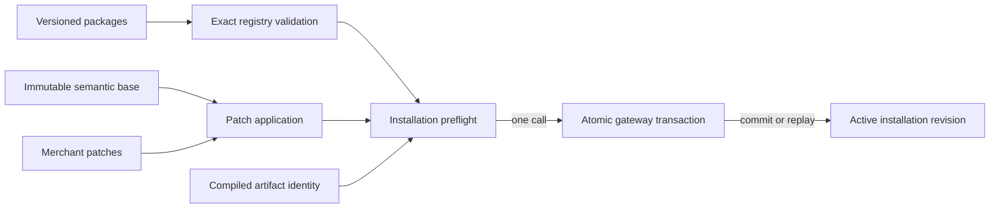

# Adaptive Commerce Semantic Core

## Purpose

Defines the versioned, validated source contracts for Adaptive Commerce and the fail-closed boundary between StoreKit discovery, merchant customization, migration, and atomic installation. This is an additive shadow system; it does not replace the active storefront or editor runtime.

## Owns

- Pure JSON + Zod contracts for DesignPacks, certified component libraries, template blueprints, StoreKits and their exact lockfiles.
- Store definitions, semantic base documents, merchant patches, commerce bindings, installations, and runtime artifact envelopes.
- Exact multi-version package registration and StoreKit installability validation.
- Deterministic semantic merchant-patch application and conservative three-way base merging.
- Installation preflight and the single atomic persistence-gateway call contract.
- Strict extraction of semantic paths from compatibility Scene Graph documents.

## Does NOT Own

- Active editor Scene Graph state or direct document mutation.
- Runtime React rendering, theme selection, publishing, canary selection, or rollout policy.
- StoreKit compilation, token resolution, responsive policy compilation, commerce-data fetching, or asset delivery.
- Database transaction implementation. The installation gateway owns the transaction and rollback mechanics.
- Guessing semantic meaning from node ids, names, visual position, or array order.

## Public API

```ts
import {
  AdaptiveCommerceRegistry,
  MerchantPatchSystem,
  StoreKitInstallationService,
  extractSemanticPaths,
  type DesignPack,
  type AdaptiveComponentLibrary,
  type TemplateBlueprint,
  type StoreKit,
  type StoreDefinition,
  type MerchantPatch,
  type RuntimeArtifact,
} from "@/adaptive-commerce";
```

The package registry is keyed by exact `id@version`. StoreKit lockfiles must pin integrity hashes for one DesignPack, one ComponentLibrary, and all eight storefront resources: Home, Product, Collection, Page, Blog, Cart, Search, and 404. The 404 route uses the canonical semantic namespace `not-found.*`.

`MerchantPatchSystem.apply()` preserves patches as a layer over an immutable semantic base. Keyed collection edits use stable keys, not array indexes. `mergeBases(oldBase, newBase, patches, renames)` applies only provably non-conflicting operations and returns unresolved conflicts with `publishable: false`; it never chooses a merchant or package value on the user's behalf.

`StoreKitInstallationService.install()` fully validates and materializes a commit before I/O, invokes `StoreKitInstallationAtomicGateway.commitAtomic()` exactly once, and verifies the echoed idempotency key, optimistic revision increment, exact resolved lockfile, active status, base identity, preset, and runtime artifact identity. The gateway implementation must commit or roll back the installation, base, merchant patches, bindings, and active artifact pointer in one database transaction.

`extractSemanticPaths()` accepts legacy Scene Graph metadata only when it maps unambiguously. Explicit `semanticPath`, `semanticKey`, `semanticRole`, certified section type, and block type metadata are supported. Unmapped nodes, invalid metadata, duplicate paths, structural errors, and cross-route paths are blocking errors.

## Depends On

- Zod for runtime contract validation.
- Scene Graph types and structural validation only in the compatibility adapter.
- No new package dependency.

The contracts, registry, patch engine, and installation domain logic do not import React, Zustand, Supabase, or the public storefront runtime.

## Folder

`src/adaptive-commerce/`

Key public system folders are `contracts/`, `registry/`, `patches/`, `installation/`, and `compatibility/`. Cross-system consumers import their `index.ts` barrels or the package barrel only.

## State Ownership

The core is stateless except for the registry's private immutable package copies. It owns no Zustand store and writes no database records directly. Merchant bases and patches remain separate values until compilation or installation. Persistence state is exclusively owned by an implementation of `StoreKitInstallationAtomicGateway`.

## Event Flow



For an upgrade, the old base, new base, explicit rename table, and merchant patches enter the three-way merge. Any unresolved overlap blocks publication and is returned as a durable conflict for merchant resolution.

## Performance Notes

- Registry lookup is constant-time by exact package key; all externally returned values are defensive copies.
- Patch ordering is deterministic by sequence then patch id.
- Semantic documents use flat paths and keyed collections so conflict scans avoid traversing runtime render trees.
- Installation performs no network or persistence work until all deterministic checks pass.

## Known Pitfalls / Anti-Patterns

- Do not resolve a version range or silently substitute a newer package for a missing lockfile pin.
- Do not flatten merchant edits into a new base or store reorder operations by array index.
- Do not auto-resolve three-way conflicts; `publishable: false` is intentional.
- Do not retry inside `StoreKitInstallationService`; retries must reuse the same idempotency key at the caller/gateway boundary.
- Do not implement a gateway with several independent writes. The method name is a contract, not proof of atomicity.
- Do not infer semantic paths from legacy node ids or merchant-facing labels.
- Do not route active storefront reads to these contracts until compilation, migration, canary, and rollback gates are separately proven.

## Extensibility

New DesignPack, component-library, blueprint, and StoreKit versions register alongside existing exact versions. Contract evolution uses explicit `schemaVersion`, engine schema, token schema, capability policy, migration ids, and integrity pins. Compatibility migrations provide explicit semantic rename tables. New persistence backends implement the single atomic gateway interface without changing registry, patch, or preflight behavior.
