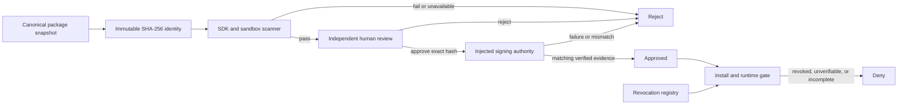

# Theme Marketplace Review System

## Purpose

Provides the local, fail-closed review contract between a deterministic Theme SDK package and an installable marketplace approval. It binds one immutable package hash to automated security evidence, an independent human decision, an injected signing request, revocation checks, optimistic revisions, idempotent commands, and a hash-chained audit trail.

## Owns

- Immutable package snapshots and canonical SHA-256 submission identities.
- The `submitted -> scanning -> needs-human-review -> signing -> approved` state machine, with terminal rejection and revocation paths.
- Automated SDK, eight-route, provenance, publisher-trust, capability, namespace, quota, and sandbox-policy checks.
- Separation of publisher and reviewer identities.
- Human decisions bound to the exact scan revision and package hash.
- Signing requests bound to the exact human decision and approval revision.
- Local optimistic-revision and command-idempotency enforcement.
- Install-time and runtime approval, signature, and revocation gates.
- An append-only, globally ordered, hash-chained local audit record and verifier.

## Does NOT Own

- Production signing keys, certificates, key rotation, HSM/KMS access, or a real signing service.
- Publisher account verification, reviewer staffing, legal review, billing, marketplace listing UI, or package distribution.
- Durable multi-instance storage, remote transparency logging, trusted timestamps, deployment, migrations, or scheduled revocation delivery.
- Theme compilation, SDK package authoring, StoreKit installation transactions, or storefront rendering.
- Capability-grant issuance. The scanner consumes a separate grant provider and fails closed when it cannot verify that evidence.

## Public API

```ts
import {
  DefaultThemeMarketplaceScanner,
  InMemoryThemeMarketplaceRevocationRegistry,
  ThemeMarketplaceConsumptionGate,
  ThemeMarketplaceReviewPipeline,
  verifyThemeMarketplaceAuditTrail,
  type MarketplaceExtensionGrantProvider,
  type MarketplacePublisherTrustProvider,
  type ThemeMarketplaceSigningAuthority,
} from "@/extension/theme-marketplace";
```

`ThemeMarketplaceSigningAuthority` is a mandatory injected boundary. This repository supplies only a test implementation in focused tests; it contains no private key and creates no production trust. Signing is invoked only after the exact hash passes automated scanning and an independent reviewer approves it. While the authority call is pending the submission is `signing`, not installable. A package becomes `approved` only after returned evidence matches the request and the same authority verifies it.

Every scan, review, and revocation command requires both `expectedRevision` and `idempotencyKey`. A successful retry returns the immutable result originally recorded for that command, even if later commands advanced the submission. Reusing its key with different content or a different expected revision is rejected.

## Depends On

- Adaptive Commerce canonical JSON and SHA-256 artifact hashing.
- Theme SDK package validation and exact eight-route StoreKit checks.
- Third-Party Extension Security Policy for trust, grants, capabilities, namespace, quotas, app blocks, and compiled-React rejection.
- Injected publisher-trust, extension-grant, signing-authority, approval, and revocation provider contracts.

## Folder

`src/extension/theme-marketplace/`

## State Ownership

The current review pipeline and revocation registry are deliberately in-memory reference implementations. They privately own defensive frozen copies, command results, and audit events; callers cannot mutate those records. No editor or document store is written.

A production service must replace this local ownership with transactional durable repositories that atomically enforce unique package hashes, optimistic revisions, idempotency records, state transitions, and audit appends across instances. This local module must not be presented as that deployed service.

## Event Flow



Each transition appends an audit event containing the submission revision, package hash, actor, previous event hash, and its own canonical event hash. `verifyThemeMarketplaceAuditTrail()` validates global sequence, unique event IDs, hash links, payload hashes, stable per-submission package identity, and non-decreasing revisions. This is integrity evidence, not an externally witnessed transparency log.

## Performance Notes

- Canonical hashing and full SDK/security validation happen at submission and review boundaries, never in storefront rendering.
- Defensive clones and deep freezes intentionally favor correctness over throughput in this local control-plane implementation.
- Install and runtime gates hash the candidate package and query approval, revocation, and signature providers on every decision so cached discovery cannot bypass later revocation.
- Durable production implementations may cache verified evidence only with a bounded lifetime and immediate revocation invalidation.

## Known Pitfalls / Anti-Patterns

- Never sign a mutable package name/version reference; sign the exact immutable package hash and human decision.
- Never treat automated scanning as human approval, or human approval as a signature.
- Never expose `signing` as approved or installable.
- Never let a publisher review their own submission.
- Never accept a caller-supplied hash without recomputing it from the frozen package snapshot.
- Never return the latest submission state for an idempotent retry; preserve the original command result.
- Never allow install or runtime use when approval, revocation, or signature verification is unavailable.
- Never equate the local audit chain with a trusted external log or configure a real private key in application code.

## Extensibility

Production adapters can implement publisher trust, grants, signing, approval lookup, and revocation registry contracts without widening package authority. A durable repository can preserve the same command/state contracts. Additional scanners may contribute evidence, but all required scanners must pass before human review and no scanner may issue approval or signing authority.

New marketplace statuses or evidence fields require a versioned contract, state-transition tests, consumption-gate validation, and audit hashing updates. Marketplace signatures never grant platform compiled-React trust; that remains an explicit internal allowlist decision in the sandbox policy.
