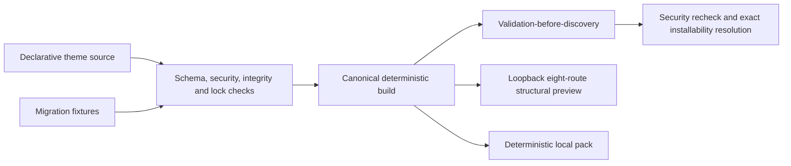

# Theme SDK

## Purpose

Provides a deterministic, fail-closed authoring and discovery path for Adaptive Commerce themes. A generated theme contains the complete eight-route StoreKit source set, exact lockfile pins, and executable migration fixtures before it can appear as installable.

## Owns

- The `storeblink theme create|check|dev|build|test|pack` command surface.
- The pure JSON + Zod `ThemeSdkPackage` envelope.
- The canonical eight-route scaffold: Home, Product, Collection, Page, Blog, Cart, Search, and 404.
- Exact DesignPack, ComponentLibrary, TemplateBlueprint, and StoreKit integrity checks.
- Deterministic build and pack serialization with SHA-256 identities.
- Migration fixtures that prove merchant patches against old and new semantic bases.
- Validation-before-discovery and validation-before-installability lookup.

## Does NOT Own

- Storefront React rendering, publication, canary selection, or database installation transactions.
- Marketplace signing, certificate issuance, publisher identity verification, or a remote package authority. The separate local review contract is documented in `theme-marketplace-review.md`.
- Grant issuance or revocation persistence for third-party capabilities.
- Arbitrary third-party React, JavaScript, CSS, network access, or build plugins.
- The legacy compiled built-in theme package format. Existing compiled themes remain restricted to the explicit platform allowlist.

## Public API

```ts
import {
  ThemeSdkDiscoveryRegistry,
  assertValidThemeSdkPackage,
  discoverBundledThemeSdkPackages,
  themeSdkPackageSchema,
  validateThemeSdkPackage,
  type ThemeSdkPackage,
  type ThemeMigrationFixture,
} from "@/extension/theme-sdk";
```

```sh
storeblink theme create <id> [--name="Theme Name"]
storeblink theme check <id-or-path>
storeblink theme dev <id-or-path> [--port=4175] [--once]
storeblink theme build <id-or-path>
storeblink theme test <id-or-path>
storeblink theme pack <id-or-path>
```

`create` writes all eight blueprints, exact StoreKit references, one merchant-patch migration fixture, a generated validation test, and a deterministic discovery artifact. `dev` binds a credential-free server to `127.0.0.1`, displays all eight route compositions from the current deterministic build, and watches source files unless `--once` is set. It is explicitly a structural SDK preview: production React, live commerce and checkout data, authenticated merchant patches, publication, and remote assets are not executed. `pack` emits a deterministic local `.sbtheme` envelope, not a signed marketplace artifact.

## Depends On

- Adaptive Commerce contracts, exact-version registry, semantic patch migration, and canonical hashing.
- The Third-Party Extension Security Policy for the package manifest boundary.
- Node standard-library filesystem, crypto, loopback HTTP, and watch APIs in CLI scripts only.
- Zod and the repository's existing Vitest setup.

## Folder

`src/extension/theme-sdk/`

The CLI implementation is in `scripts/storeblink.mjs`, `scripts/theme-sdk-lib.mjs`, and `scripts/theme-sdk-scaffold.mjs`. Generated packages live under `src/themes/<theme-id>/` by default.

## State Ownership

The SDK owns no editor store and performs no database writes. `ThemeSdkDiscoveryRegistry` privately owns defensive, exact-version package copies plus unregister callbacks. Build output is derived state under a theme's `dist/` directory. The source JSON and migration fixtures remain the authoring source of truth. The development preview owns only an in-memory pointer to the last valid build and a loopback server/watcher lifecycle.

## Event Flow



Discovery registers the package into an isolated Adaptive Commerce registry only after full validation. A partial registration is rolled back. `resolveInstallable()` rechecks the current capability grant so a revoked or expired package cannot rely on an earlier discovery decision.

## Performance Notes

- Files and package keys are sorted before hashing or packing, so timestamps and filesystem enumeration order do not affect identity.
- Bundled discovery uses an eager JSON-only Vite glob; it does not import third-party executable modules.
- The local preview has no scripts, credentials, service calls, or outbound network dependency and sends restrictive CSP and same-origin isolation headers.
- Validation is intentionally comprehensive and belongs at check, build, discovery, and installation boundaries rather than the render hot path.

## Known Pitfalls / Anti-Patterns

- Do not replace exact StoreKit pins with ranges, latest-version lookup, or integrity substitution.
- Do not omit Blog or 404; the latter uses the semantic `not-found.*` namespace.
- Do not treat a matching package hash as publisher authorization or marketplace signing.
- Do not expose a package after a failed check, migration fixture, or partial registry registration.
- Do not bind the SDK preview to a public interface or present it as a production storefront acceptance test.
- Do not add timestamps, absolute paths, or unsorted filesystem output to deterministic artifacts.
- Do not compile third-party React. Compiled React is reserved for explicitly allowlisted platform packages.

## Extensibility

Additional declarative token, component, blueprint, asset, or safe-expression schemas can be added through a new explicit package format version. New StoreKit versions coexist by exact `id@version`; migrations remain executable fixtures. The local Theme Marketplace Review System may attach injected approval evidence outside this package, but it still reruns all semantic and security validation. That reference pipeline contains no production key or deployed signing authority.
