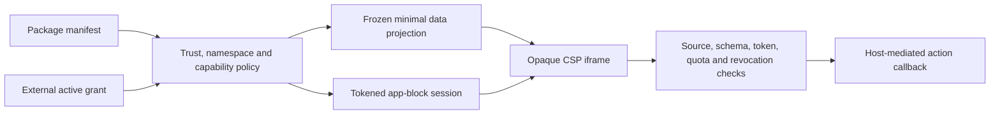

# Third-Party Extension Sandbox

## Purpose

Enforces a capability-scoped boundary for third-party theme and app packages. Third-party packages are declarative by default; interactive app blocks render a platform-owned declarative view inside an opaque-origin iframe and can request only host-mediated actions.

## Owns

- Versioned third-party manifest, external grant, trust-level, capability, namespace, slot, quota, and revocation contracts.
- Fail-closed discovery policy and explicit platform compiled-React allowlisting.
- Minimal read-only data projection with deep freezing and byte quotas.
- The versioned, random-token `postMessage` protocol for app-block sessions.
- Opaque iframe source generation with a strict Content Security Policy.
- Source-window, schema, protocol, token, capability, payload, rate, expiry, and revocation checks.

## Does NOT Own

- Capability grant issuance, publisher verification, marketplace signing, key management, or revocation persistence.
- Direct DOM, cookies, credentials, local storage, Supabase clients, arbitrary network access, or parent-window handles for extensions.
- Commerce mutations. The host application decides whether and how to execute an accepted mediated action.
- Third-party JavaScript, React, HTML, or CSS execution. App-block views are static declarative elements rendered by platform code.
- Merchant-authored custom-code behavior. The existing custom-code iframe remains a separate compatibility system with its own contract.

## Public API

```ts
import {
  AppBlockHost,
  AppBlockSession,
  ExtensionSecurityPolicy,
  createAppBlockDataProjection,
  createAppBlockFrameDocument,
  extensionGrantSchema,
  thirdPartyExtensionManifestSchema,
  type ExtensionGrant,
  type ThirdPartyExtensionManifest,
} from "@/extension/app-block";
```

The package manifest may request capabilities, but it cannot authorize itself. `grantedCapabilities` must exactly echo a separate active `ExtensionGrant`; app blocks without such a grant are rejected. Compiled React additionally requires platform trust, the `platform/compiled-react` capability, an enabled platform policy, and membership in an internal package-id allowlist.

## Depends On

- Zod for strict runtime parsing.
- Browser cryptographic randomness for 256-bit session tokens.
- React only in the platform-owned `AppBlockHost` wrapper.
- Adaptive Commerce identifier contracts for exact package identity.

## Folder

`src/extension/app-block/`

The compiled-theme platform allowlist is owned by `src/theme-engine/security/platformThemeTrust.ts` and is enforced by built-in discovery and the Theme Package Registry.

## State Ownership

`AppBlockSession` owns only ephemeral token, action-window, and local revocation state for one frame. `AppBlockHost` owns frame height and rendering error UI. Minimal projected data is deeply frozen. Durable grants and revocations must be owned by a future authenticated platform service; this module accepts them as validated inputs and never fabricates authority.

## Event Flow



The iframe has `sandbox="allow-scripts"` without `allow-same-origin`. Its CSP denies all default sources and network connections, permits only nonce-bound platform script/style, and disallows forms, nested frames, workers, objects, base URLs, and navigation. The renderer creates elements and assigns text; it never evaluates extension source or injects HTML.

## Performance Notes

- Each frame has one isolated session and a bounded 60-second action timestamp window.
- Projection and message sizes are measured before crossing the boundary.
- View elements, blocks, actions, and frame height have hard schema and grant quotas.
- Security evaluation belongs before discovery and again before installability or session creation.

## Known Pitfalls / Anti-Patterns

- Never use manifest-declared grants as authorization; require the separate platform record.
- Never add `allow-same-origin`, `unsafe-eval`, remote script/style origins, or arbitrary `connect-src` access.
- Never trust `event.origin` for an opaque frame; verify `event.source` and the session token as well as the full strict message schema.
- Never pass raw store objects, credentials, DOM references, functions, or mutable data into a frame.
- Never equate signed publisher identity with sandbox isolation or platform trust.
- Never accept a capability, namespace, slot, or action not present in the closed contract.

## Extensibility

New messages require a protocol version and strict host/frame schemas. New actions require a named capability and a platform mediator. New data fields require a capability-gated projection path. Higher trust may widen declarative quotas, but executable platform React remains an explicit internal allowlist decision and does not become available through marketplace signatures alone.
