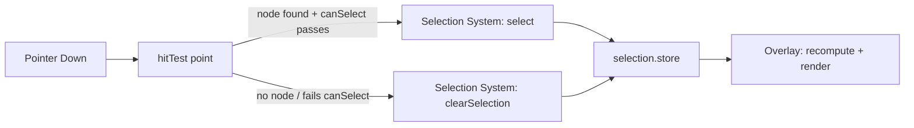
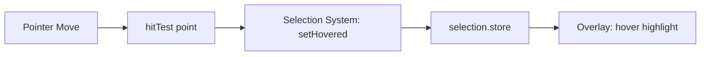

# PHASE 4 — Selection Engine & Overlay Foundation (Enhanced)

## Role

Principal Software Architect / Senior React-TypeScript Engineer / Performance Engineer, continuing the same engine. This is the first phase where a "Do NOT implement" list from an earlier phase finally flips to "implement."

## Required Reading Before You Start

- `docs/ARCHITECTURE.md` §9.9 (Overlay System spec), §9.10 (Selection System spec — note it's **one** system, not an "Engine" plus a "Manager").
- `docs/PHASE-1-SUMMARY.md` — `NodeMeta.locked`/`.hidden`, and the Engine Event Bus (`scene:node:deleted` matters a lot this phase — see §1.4 below).
- `docs/PHASE-2-SUMMARY.md` — the "Renderer knows nothing about Selection" rule from Phase 2 is bidirectional: Selection also knows nothing about Renderer. See the correction in §1.3.
- `docs/PHASE-3-SUMMARY.md` — this phase is the **first real consumer** of `hitTest()`, `getAABB`/`getOBB`, and `getWorldTransform`. If any of those don't exist yet, stop and flag it rather than reimplementing a shortcut version inline.

## Hard Constraints

Same as prior phases: no UI redesign, no rewriting working code, no deleted functionality, preserve backward compatibility, reuse existing code, architecture before features.

## Explicit Out of Scope for Phase 4

Resize, Rotate, Move, Scale, Dragging, Smart Guides, Snap, History, Command System, Inspector *editing* (read-only display of what's selected is fine, editing values is not), Keyboard shortcuts, Moveable, Selecto, true multi-selection (shape the data for it — see §2 — but don't build marquee/shift-click logic yet).

Selection tells the system what's targeted. It does not let anyone change what's targeted.

---

## Step 0 — Architecture Audit (Gate — do not skip)

1. Analyze current selection logic, click handlers, active-element logic, existing bounding-box code, current state management around selection.
2. Identify duplicated logic, inconsistent selection state, tight coupling, unnecessary DOM manipulation.
3. Produce **`docs/PHASE-4-AUDIT.md`**.
4. **Stop and wait for explicit confirmation before Step 1.**

---

## Step 1 — Selection System

**Consolidation vs. the original brief**, which split this into "Selection Engine" (Step 2), "Selection Manager" (Step 5), and "Selection Events" (Step 6) — three names for one system in `ARCHITECTURE.md` §9.10, with "Selection Validation" duplicated across the first two. One system, two internal files:

### 1.1 — `state.ts` (fulfills the original "Selection Engine")

```ts
interface SelectionAPI {
  select(ids: NodeId[]): void;          // replaces current selection
  toggleSelection(id: NodeId): void;
  clearSelection(): void;
  setHovered(id: NodeId | null): void;
  getSelected(): NodeId[];
  getActive(): NodeId | null;           // primary/most-recent of getSelected() — see §2
  getHovered(): NodeId | null;
  isSelected(id: NodeId): boolean;
  getSelectionBounds(): Rect | null;    // unionBounds() over getWorldTransform()+getAABB() per selected node
}

function canSelect(node: SceneNode | undefined): boolean {
  return !!node && !node.meta.locked && !node.meta.hidden;
}
```

### 1.2 — `input-orchestrator.ts` (fulfills the original "Selection Manager" + "Selection Events")

Wires pointer events to the state API above via Hit Testing. This is the only place pointer coordinates get translated into a selection decision.

### 1.3 — Dependency correction

`ARCHITECTURE.md` §9.10 lists Selection's dependencies as **Hit Testing System + Scene Graph**, plus (narrowly, just for `getSelectionBounds()`) **Geometry System**. It does **not** depend on Renderer. The original brief's Step 3 correctly states "Selection must not depend on Renderer" — Step 5 then contradicts this by listing Renderer as something the Selection Manager talks to. Step 3 is right; drop Renderer from the dependency list. This isn't pedantic — Phase 2 established that Renderer knows nothing about Selection specifically so the two could evolve independently; a dependency in the other direction reintroduces the same coupling from the opposite side.

### 1.4 — Why `canSelect()` still matters even though Hit Testing already filters locked/hidden nodes

Phase 3's `hitTest()` already excludes locked/hidden nodes from its results — so on the surface, re-checking `canSelect()` in Selection System looks redundant. It isn't: Hit Testing's filter only protects the *canvas-click* path. This phase's own closing requirement is that future phases (Layers panel selection, keyboard navigation, undo/redo restoring a prior selection) must be able to attach to this architecture without refactoring it — none of those paths go through `hitTest()` at all. `canSelect()` is the one gate all of them will call before accepting a selection, whether or not hit testing was involved.

### 1.5 — Dangling-reference protection (missing from the original brief entirely)

Subscribe to the Phase 1 Engine Event Bus's `scene:node:deleted` event and prune any deleted `id` from `selectedIds`/`hoveredId` when it fires. Nothing in this phase deletes nodes (Commands are out of scope), but a future Command will, and without this, Overlay will attempt to compute bounds for a node that no longer exists in the Scene Graph.

**Folder:** `src/interaction/selection/` (`state.ts`, `input-orchestrator.ts`, `index.ts`)

---

## Step 2 — Selection Store

**Unlike Phases 1–3, this one correctly belongs in Zustand** — selection is exactly the kind of state components need to reactively subscribe to (Overlay now, Inspector and Toolbar later). No correction needed here, in contrast to the last three phases' "does this really need to be a store" catches.

```ts
interface SelectionStoreState {
  selectedIds: NodeId[];   // array from day one — Phase 4 only ever sets [] or [oneId],
                           // but this avoids a schema migration when multi-select lands
  hoveredId: NodeId | null;
  activeId: NodeId | null; // derived: last id in selectedIds; distinct field now so a future
                           // multi-select Inspector doesn't need a schema change to know which
                           // selected node is "primary"
}
```

**Dropped from the original brief's Step 3, with reasoning:** `Selection Mode`, `Selection Source`, `Selection Metadata` — none has a named consumer yet. "Mode" (single vs. marquee) is a Tool System concern once Selecto lands, not Selection Store's. "Source" (canvas click vs. layers-panel click vs. keyboard) is real and useful *once a Layers panel exists* to disambiguate — it doesn't yet in this phase. Add these when something actually reads them; building them now is exactly the "unnecessary abstraction" this project's own constraints warn against.

**Folder:** `src/stores/selection.store.ts`

---

## Step 3 — Overlay System

**Consolidation vs. the original brief**, which split this into "Selection Overlay" (Step 4) and "Overlay Renderer" (Step 7) — both list nearly the same responsibilities (outline, border, padding, margin, highlight). One system, split usefully — mirroring the Renderer/Renderer-Registry split from Phase 2 — into pure computation vs. React rendering:

```ts
// pure — no React, no DOM
function computeOverlayVisuals(
  selection: { selectedIds: NodeId[]; hoveredId: NodeId | null },
  sceneGraph: SceneGraphAPI,
  viewport: ViewportAPI
): OverlayVisual[]   // each: { nodeId, screenRect, kind: 'selected' | 'hovered' }
```

```tsx
// React — subscribes to selection.store + viewport.store, calls computeOverlayVisuals, renders SVG/DOM
function OverlayRenderer(): JSX.Element
```

**Concrete implementation detail the original brief omits entirely, and a real bug if missed:** the overlay's root element must have `pointer-events: none`. Without it, the overlay layer sits visually on top of the canvas and will intercept the *next* pointer-down — meaning clicking an already-selected element a second time hits the overlay instead of the node underneath, and nothing happens. (Individual handle elements will need to selectively re-enable `pointer-events` once Transform/Moveable land in a later phase — not needed yet since there are no handles this phase, only outlines.)

**Why this lives in `rendering/overlay/` and not next to `interaction/selection/`,** despite the two being tightly coupled by data flow: `ARCHITECTURE.md` §10 places Overlay in the Rendering Layer and Selection in the Interaction Layer — the split is about *kind of concern* (intent/state vs. visual presentation), the same reasoning that keeps Hit Testing and Renderer in separate folders in Phase 3 despite one feeding the other.

**Folder:** `src/rendering/overlay/` (`geometry.ts`, `OverlayRenderer.tsx`, `index.ts`)

---

## Step 4 — Event Flow

### Click → select


### Move → hover (missing from the original brief — added here so Overlay's "Hover Highlight" has a data source)


Hover runs on every pointer move, so it leans directly on Phase 3's spatial index — this is exactly the workload that index was built for.

---

## Step 5 — Performance

The original brief's "avoid re-rendering the complete canvas" goal is satisfied structurally, not by an optimization pass bolted on afterward:

- **Overlay subscribes to `selection.store` (and `viewport.store`). Nothing else does.**
- **Node renderer components (Phase 2) never subscribe to `selection.store` at all.** Selection visuals are a separate overlay layer drawn on top — Step 3's "overlay never modifies DOM nodes [of the underlying elements]" rule guarantees this. So selecting or hovering a node causes zero node-renderer re-renders; only the Overlay layer repaints.
- Verify this, don't just assume it — see the render-count test in Step 7.

---

## Step 6 — Folder Structure

```
src/
├── interaction/
│   └── selection/
│       ├── state.ts               # Selection Engine (orig. Step 2)
│       ├── input-orchestrator.ts  # Selection Manager + Selection Events (orig. Steps 5-6)
│       └── index.ts
├── rendering/
│   └── overlay/
│       ├── geometry.ts            # pure computation (orig. part of Steps 4 & 7)
│       ├── OverlayRenderer.tsx    # React rendering (orig. part of Steps 4 & 7)
│       └── index.ts
└── stores/
    └── selection.store.ts
```

No `selection-manager/`, `selection-events/`, `selection-types/`, `selection-utils/` as separate top-level folders — internal organization within the two folders above.

---

## Step 7 — Verification Gate

- [ ] `npm run test` green, including:
  - `state.ts`: select/toggle/clear/hover transitions; `canSelect` rejects locked, hidden, and nonexistent node ids; `getSelectionBounds` returns the correct union rect for a rotated selected node (exercises Phase 3's Geometry System).
  - Dangling-reference: deleting a selected node's id via a simulated `scene:node:deleted` event prunes it from `selectedIds`.
  - Click simulation: pointer-down over a rendered node selects it via real `hitTest()`; pointer-down on empty canvas clears selection; pointer-move over a node sets `hoveredId` without touching `selectedIds`.
  - Render-count check: selecting/hovering a node does not increment the render count of any node-renderer component (spy/counter assertion) — this is what actually proves Step 5, not just an assumption.
- [ ] `npm run lint` passes
- [ ] `npm run build` succeeds
- [ ] `npm run dev` — manual smoke test: click selects, click-empty deselects, outline appears and tracks the node, clicking an already-selected node a second time still works (confirms `pointer-events: none` is actually set)
- [ ] No existing feature regressed

---

## Deliverables Checklist

- [ ] `docs/PHASE-4-AUDIT.md` (reviewed/approved before proceeding)
- [ ] Selection System (`interaction/selection/`) — state + input orchestrator, `canSelect`, dangling-reference pruning
- [ ] Selection Store (`stores/selection.store.ts`) — `selectedIds`, `hoveredId`, `activeId` only
- [ ] Overlay System (`rendering/overlay/`) — pure geometry + React renderer, `pointer-events: none` confirmed
- [ ] Click and hover event flows wired end-to-end through real Hit Testing
- [ ] All Step 7 checks passing, including the render-count proof
- [ ] `docs/PHASE-4-SUMMARY.md` — what's built, what Phase 5 (Transform/Moveable) will attach to (`getSelectionBounds()`, the existing Overlay layer for handles), and confirmation that `selection.store`'s shape needs no migration for multi-select

## Corrections Recap

1. Selection Engine + Selection Manager + Selection Events → one Selection System (state + orchestrator).
2. Selection Overlay + Overlay Renderer → one Overlay System (pure geometry + React component).
3. Dependency contradiction resolved: Selection does not depend on Renderer, in either direction.
4. Hover tracking added — the original brief's Overlay promised a "Hover Highlight" with no data source for it.
5. Dangling-reference pruning added via the Phase 1 Event Bus — absent from the original brief.
6. `pointer-events: none` on the Overlay root called out explicitly as a specific, real bug otherwise.
7. `Selection Mode`/`Source`/`Metadata` dropped from the store pending a named consumer.

## Stop Condition

Do not implement Resize, Rotate, Move, Snap, or Moveable/Selecto integration — not even a minimal drag-to-move "just to see the overlay track something." If you want to verify the overlay updates correctly under movement, do it by changing a node's transform directly in a test fixture and re-rendering, not by wiring up real dragging. Note any real transform interaction as a Phase 5 dependency in `PHASE-4-SUMMARY.md`.
