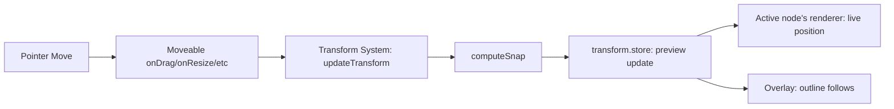
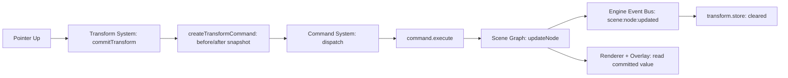

# PHASE 5 — Transform Engine, Moveable & Multi-Selection (Enhanced)

## Role

Principal Software Architect / Senior React-TypeScript Engineer / Performance Engineer, continuing the same engine.

## Required Reading Before You Start

- `docs/ARCHITECTURE.md` §9.3 (Command System), §9.11 (Transform System — **already specifies `commitTransform()` dispatches a Command**), §9.12 (Snap Engine).
- `docs/PHASE-1-SUMMARY.md` — the rule that `scene.store` has exactly one writer (Command System) matters more this phase than any prior one, because this is the first phase where user input actually wants to mutate it.
- `docs/PHASE-2-SUMMARY.md` — the `invalidate()`/`flush()` rAF-batching pattern from the Renderer is reused here for transform ticks.
- `docs/PHASE-3-SUMMARY.md` — `hitTestRegion(rect)` was built specifically for marquee selection; this is where it finally gets called. The "Hit Testing never reads the DOM" rule still applies and is at risk in §5 below.
- `docs/PHASE-4-SUMMARY.md` — `selectedIds: NodeId[]` was shaped as an array from day one specifically for this phase's multi-selection. Also: the "node renderers never subscribe to interaction state" rule gets one narrow, explicit exception this phase (§3).

## Hard Constraints

Same as prior phases, plus: Moveable and Selecto are implementation tools, never the architecture. The Scene Graph remains the sole source of truth; these libraries are not allowed to hold state our systems need to know about.

## Explicit Out of Scope for Phase 5 — Revised

Clipboard, Inspector *editing*, Auto Layout, Components, Variables, Asset Manager, and — **the undo/redo stack, keyboard shortcuts (Ctrl+Z/Ctrl+Y), and any UI surfacing undo/redo state.** That's what "no History" should mean.

**What "no History" does not mean: no Command System.** See Step 1 — this is the headline correction of this phase and it's not optional; it's fixing a direct contradiction with `ARCHITECTURE.md` §9.11, not imposing new scope for its own sake.

---

## Step 0 — Architecture Audit (Gate — do not skip)

1. Analyze current Scene Graph, Selection System, Overlay System, Geometry System, Coordinate System, Renderer, Viewport — specifically how each will be touched by live transform ticks vs. one-time commits.
2. Identify: duplicated transform math, any direct DOM manipulation for positioning, tightly coupled code.
3. Produce **`docs/PHASE-5-AUDIT.md`**.
4. **Stop and wait for explicit confirmation before Step 1.**

---

## Step 1 — Command System (Minimal — Not History)

**This is the correction that matters most in this phase.** `ARCHITECTURE.md` §9.11, written before any of these five phases were drafted, already states that Transform System's `commitTransform()` dispatches a Command and that Transform depends on Command System. Building Transform without it isn't "deferring a future system" — it's building against a spec that already assumes this exists.

What actually gets built — deliberately thin, no stack, no UI, no keyboard shortcuts:

```ts
// engine/command/types.ts
interface Command<T = unknown> {
  id: string;
  type: string;
  timestamp: number;
  payload: T;
  execute(ctx: EngineContext): void;
  undo(ctx: EngineContext): void;
  merge?(next: Command): Command | null;  // interface present, unused this phase — see note below
}
```

```ts
// engine/command/dispatcher.ts
function dispatch<T>(command: Command<T>, ctx: EngineContext): void {
  command.execute(ctx);
  // Phase 6 adds exactly one line here: historyStore.push(command). That's the whole point of building this now.
}
```

**One factory, not four.** `ARCHITECTURE.md` §9.3's `createMoveCommand`/`createResizeCommand` sketch was illustrative, not a mandate for one factory per gesture type. Move/Resize/Rotate/Scale all reduce to the identical shape — a before/after transform snapshot per affected node — so one factory covers all four:

```ts
interface TransformCommandPayload {
  changes: Array<{ nodeId: NodeId; before: TransformData; after: TransformData }>;
}

function createTransformCommand(
  kind: 'move' | 'resize' | 'rotate' | 'scale',
  changes: TransformCommandPayload['changes']
): Command<TransformCommandPayload> {
  return {
    id: generateId(),
    type: `transform:${kind}`,
    timestamp: Date.now(),
    payload: { changes },
    execute: (ctx) => changes.forEach(c => ctx.sceneGraph.updateNode(c.nodeId, { transform: c.after })),
    undo: (ctx) => changes.forEach(c => ctx.sceneGraph.updateNode(c.nodeId, { transform: c.before })),
  };
}
```

(A future `createDeleteCommand` still gets its own factory later — deletion's execute/undo semantics genuinely differ from "change a transform value." The consolidation applies to the four transform-shaped commands, not to every command forever.)

**Why `merge()` is a no-op stub this phase:** it exists on the interface per `ARCHITECTURE.md` §9.3 for coalescing rapid commands (e.g., repeated keyboard nudges once that exists), but this phase dispatches exactly one Command per gesture — at commit, not per tick (see Step 2) — so there's nothing to coalesce yet. Implement the field, leave the logic unused rather than inventing a scenario for it.

**Folder:** `engine/command/` — this is the folder `ARCHITECTURE.md` §6 reserved in its very first draft of the repo layout. This phase is where it actually gets filled in. `engine/history/`, also reserved there, stays empty until the dedicated History phase.

---

## Step 2 — Transform System

**Consolidation vs. the original brief**, which split this into "Transform Engine" (Step 2) with Move/Resize/Rotate/Scale/Validation/Constraints, and "Transform Manager" (Step 5) with Start/Update/End/Validation/Constraints — fourth occurrence of the same pattern from Phases 1, 3, and 4. One system, matching `ARCHITECTURE.md` §9.11's API exactly:

```ts
interface TransformAPI {
  beginTransform(ids: NodeId[], kind: 'move' | 'resize' | 'rotate' | 'scale'): void;
  updateTransform(delta: Partial<TransformData> | Point): void;  // live preview only
  commitTransform(): void;    // computes final before/after snapshots, dispatches one Command
  cancelTransform(): void;    // discards preview, dispatches nothing
}
```

**The critical distinction, straight from `ARCHITECTURE.md` §9.11:** *"Moveable's live drag events update a local/uncommitted transform preview; only `commitTransform()` creates a Command."* Concretely:

- `updateTransform()` fires on every pointer-move tick during a gesture (potentially 60+/sec). It writes only to `transform.store` (Step 3) — **never to `scene.store`.** This preserves "Command System is the only writer to `scene.store`," even during an active drag.
- `commitTransform()` fires once, on gesture end. It reads the final preview value(s) from `transform.store`, builds the before/after snapshot(s), and calls `dispatch(createTransformCommand(...))` — this is the one and only point where `scene.store` actually changes.
- `cancelTransform()` (e.g. Escape key mid-drag) clears `transform.store` and dispatches nothing — `scene.store` was never touched, so there's nothing to undo.

**Constraint checking disambiguation:** "Constraint Checking" here means transform-gesture limits — min/max size, keep-aspect-ratio, transform-origin bounds — validated inside `updateTransform()`/`commitTransform()`. This is **not** the Layout Layer's future Constraint System (`ARCHITECTURE.md` §10 #30), which handles parent-relative pinning/stretching for responsive layout and arrives in a much later phase. Similar name, unrelated concern — don't let Transform System depend on the Layout Constraint System; keep gesture-limit validation local.

**Folder:** `interaction/transform/`

---

## Step 3 — Transform Store

**Legitimately Zustand** — like Phase 4's Selection Store, this is reactive state components genuinely need to subscribe to (the transforming node's own renderer, and Overlay, both need to update on every tick).

```ts
interface TransformStoreState {
  activeNodeIds: NodeId[];
  gestureKind: 'move' | 'resize' | 'rotate' | 'scale' | null;
  previewTransforms: Record<NodeId, TransformData>;  // live, uncommitted values
}
```

**A deliberate, narrow exception to Phase 4's rule.** Phase 4 established that node renderer components never subscribe to `selection.store` — selection visuals live entirely in the separate Overlay layer. Transform is different: the node itself has to visibly move/resize/rotate during the gesture, not just get an outline drawn around a stale position. So: **the actively-transforming node's own renderer subscribes to `transform.store`** (selector keyed to its own node id) and merges the live preview over its `scene.store` value when present; every other node's renderer is untouched. Overlay also consults `transform.store` the same way, to keep the selection outline glued to the node during the drag — this extends the `computeOverlayVisuals()` function built in Phase 4, it doesn't replace it.

**Folder:** `stores/transform.store.ts`

---

## Step 4 — Moveable Integration

Wraps `react-moveable`, translating its drag/resize/rotate/scale callbacks into `beginTransform`/`updateTransform`/`commitTransform`/`cancelTransform` calls. Moveable talks to Transform System only — it never touches `scene.store` or the Scene Graph directly.

**This is the exact moment Phase 4 was preparing for.** Phase 4's Overlay root has `pointer-events: none` specifically so outlines don't block clicks. Moveable's actual interactive handles need `pointer-events: auto` set on themselves individually, mounted inside that same Overlay layer (`ARCHITECTURE.md` §9.9 already lists "handle positions" as something Overlay owns) — not as a separate parallel DOM layer Moveable creates on its own.

Moveable's own internal DOM measurement of its target element (to position its handles) is fine and expected — that's inherent to being an interactive widget, and it's a different concern from Hit Testing's job of resolving "which Scene Graph node is under a point" (already resolved, via Selection, before Moveable ever mounts).

**Folder:** `interaction/transform/MoveableAdapter.tsx`

---

## Step 5 — Selecto Integration

Selecto talks to Selection System only, per the original brief's own rule — correctly kept as-is.

**A real integration risk the original brief doesn't flag:** Selecto's default behavior does its own DOM-based element matching internally to figure out which elements a drag rectangle covers. Using that result directly as "which nodes are selected" would quietly reintroduce the DOM-measurement anti-pattern Phase 3's Hit Testing System was specifically built to eliminate.

**Fix:** use Selecto only to capture the drag rectangle (and, if convenient, its default marquee-box visual — that's transient input-gesture UI, not app state worth reimplementing). Convert the rectangle to document space via the Coordinate System and pass it to **`hitTestRegion(rect)`** — built in Phase 3 anticipating exactly this — to get the actual selected node ids. Hit Testing stays the single source of truth for "what's under this area."

This is also the payoff for Phase 4's `selectedIds: NodeId[]` being array-shaped from day one — marquee/shift/ctrl selection call `select(ids)`/`toggleSelection(id)` with multiple ids now, with zero schema change to Selection Store.

**Folder:** `interaction/selection/SelectoAdapter.tsx` (co-located with Selection, since it only ever talks to it)

---

## Step 6 — Snap Foundation

**Scope line, more concrete than the original brief's "foundation only":** Grid/Edge/Center/Pixel snap are simple threshold comparisons — implement them for real now, since dragging without any snap is genuinely hard to use precisely and there's no meaningful "foundation-only" version of basic math. What's actually deferred is **Smart Guides and Distance Guides** — those need cross-object nearest-neighbor logic and their own visual rendering, which is real additional scope, unlike grid/edge/center snap.

```ts
function computeSnap(
  activeBounds: Rect,
  siblingBounds: Rect[],
  gridSize: number,
  threshold: number
): { snappedDelta: Point; guides: SnapGuide[] }   // `guides` is unused/empty this phase — Smart Guides populates it later
```

Called synchronously inside `updateTransform()` to adjust the live delta before it's written to `transform.store`.

**No Snap Store.** There's no visual guide-line to render yet (Smart Guides are deferred), so there's nothing here that needs to be reactive UI state — `computeSnap()` is a pure function call inside Transform System's own update loop. When Smart Guides land and Overlay needs to render "which guide lines are currently active," *that's* when a snap store holding that transient visual state becomes legitimate — not before.

**Folder:** `interaction/snap/`

---

## Step 7 — Event Flows

### Live tick (many times per gesture — never touches `scene.store`)


### Commit (once per gesture — the only point `scene.store` changes)


Note the seam: when Phase 6 adds History, it hooks into the `DISP` step above (`dispatch()` pushes to a stack) — nothing about this flow changes.

---

## Step 8 — Performance

- Batch `updateTransform()` writes into `requestAnimationFrame` ticks — same rAF-batching idiom as the Renderer's `invalidate()`/`flush()` from Phase 2, not a new mechanism.
- `transform.store` selectors stay granular: only the actively-transforming node's renderer and Overlay re-render per tick; every other node is untouched.
- Cache `getWorldTransform()` results per Phase 3's caching scheme — don't recompute the full ancestor chain every tick for nodes that aren't moving.
- Support 1,000+ elements: the only per-tick cost should scale with the number of nodes actively being transformed (usually 1, occasionally a multi-selection group), not with total scene size.

---

## Step 9 — Stores

- **`transform.store`** — new, legitimate (Step 3).
- **No Snap Store** — see Step 6.
- **No Moveable Store** — Moveable is a view-layer implementation detail per this phase's own stated rule ("never allow business logic inside them"). Any local UI state (e.g. which handle is currently being dragged) is plain React `useState` inside the adapter component — nothing else in the app needs to know that reactively.
- Still no History Store — deferred to Phase 6.

---

## Step 10 — Folder Structure

```
src/
├── engine/
│   └── command/                    # new — reserved since ARCHITECTURE.md §6, built out now
│       ├── types.ts
│       ├── dispatcher.ts
│       └── factories/
│           └── transformCommand.ts
├── interaction/
│   ├── transform/
│   │   ├── state.ts                # Transform Engine + Transform Manager, consolidated
│   │   └── MoveableAdapter.tsx
│   ├── selection/
│   │   └── SelectoAdapter.tsx      # co-located with Selection, not Transform
│   └── snap/
│       └── computeSnap.ts
└── stores/
    └── transform.store.ts
```

---

## Step 11 — Verification Gate

- [ ] `npm run test` green, including:
  - Command System: `dispatch()` calls `execute()`; `execute()` correctly writes `scene.store`; calling `undo()` directly (even with nothing consuming it yet) correctly restores the "before" snapshot — proves the seam works before Phase 6 exists to use it.
  - Transform System: `scene.store` is provably untouched during `updateTransform()` calls, and changes exactly once on `commitTransform()`; `cancelTransform()` leaves `scene.store` untouched and dispatches no Command.
  - Selecto: marquee rectangle over a synthetic multi-node scene selects exactly the nodes whose Scene-Graph-derived bounds intersect it, via `hitTestRegion` — not via DOM measurement.
  - Snap: grid/edge/center snap produce correct clamped deltas against known fixtures.
  - Render-count check: transforming one node doesn't re-render sibling node components — only the active node + Overlay update per tick.
- [ ] `npm run lint` passes
- [ ] `npm run build` succeeds
- [ ] `npm run dev` — manual smoke test: drag/resize/rotate/scale a single node and a multi-selection; Escape cancels cleanly; marquee-select works; existing functionality unchanged
- [ ] No existing feature regressed

---

## Deliverables Checklist

- [ ] `docs/PHASE-5-AUDIT.md` (reviewed/approved before proceeding)
- [ ] Minimal Command System (`engine/command/`) — interface, dispatcher, one consolidated transform-command factory
- [ ] Transform System (`interaction/transform/state.ts`) with live-preview/commit split
- [ ] `transform.store`
- [ ] Moveable adapter mounted inside the existing Overlay layer with selective `pointer-events: auto` on handles
- [ ] Selecto adapter feeding `hitTestRegion()`, not Selecto's own DOM matching
- [ ] Snap foundation (grid/edge/center/pixel, real; Smart/Distance Guides deferred)
- [ ] All Step 11 checks passing, including the `scene.store`-untouched-during-drag proof
- [ ] `docs/PHASE-5-SUMMARY.md` — confirm the `dispatch()` seam is exactly one line away from supporting History, and hand off explicit scope for Phase 6

## Corrections Recap

1. **Headline correction:** minimal Command System built now, not deferred — `ARCHITECTURE.md` §9.11 already required it; only the History stack itself is still deferred.
2. Transform Engine + Transform Manager merged into one Transform System (fourth occurrence of this pattern across the series).
3. Live-preview (`transform.store`) vs. commit (`scene.store` via Command) split, preserving "Command is the only `scene.store` writer" even mid-gesture.
4. One narrow, explicit exception to Phase 4's "renderers don't subscribe to interaction state" rule, scoped only to the actively-transforming node's own position/size.
5. Selecto's built-in DOM matching is not used as the selection source of truth — `hitTestRegion()` is, preserving Phase 3's no-DOM-reads rule.
6. No Snap Store, no Moveable Store — neither is reactive state anything needs to subscribe to yet.
7. Four command factories consolidated into one, since Move/Resize/Rotate/Scale share an identical before/after shape.
8. `engine/command/` — confirmed as the folder `ARCHITECTURE.md` reserved from its first draft, now finally populated.

## Recommendation for Phase 6

Scope it tightly: History Store (undo/redo stack — this one legitimately is reactive, since a toolbar needs to show enabled/disabled undo/redo state), the one-line addition to `dispatch()`, keyboard shortcuts, and — only if needed by then — real logic behind `merge()` for coalescing rapid repeated commands (e.g. arrow-key nudging). Because Commands already fully exist after this phase, Phase 6 should be one of the smallest phases in the series, not one of the largest.

## Stop Condition

Do not implement Clipboard, Inspector editing, Auto Layout, Components, Variables, Asset Manager, the undo/redo stack itself, or keyboard shortcuts. If Transform seems to want a keyboard shortcut (e.g. arrow-key nudge), note it in `PHASE-5-SUMMARY.md` as a Phase 6 dependency rather than adding it here.
