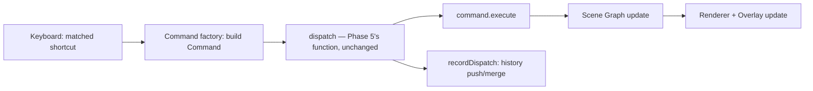
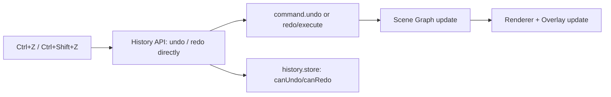

# PHASE 6 — Command Engine, History System, Clipboard & Keyboard Architecture (Enhanced)

## Role

Principal Software Architect / Senior React-TypeScript Engineer / Performance Engineer, continuing the same engine.

## Required Reading Before You Start

- `docs/ARCHITECTURE.md` §9.3 (Command System), §9.4 (History System), §10 (note Clipboard is listed under the **Persistence Layer**, not alongside Command/History).
- `docs/PHASE-5-SUMMARY.md` — **critical, more than usual.** Phase 5 already built `engine/command/` — the `Command` interface, `dispatch()`, and a consolidated transform-command factory — specifically so this phase wouldn't need to. Its `dispatch()` function has a comment: `// Phase 6 adds exactly one line here: historyStore.push(command)`. That line is most of Step 2 below. Read the actual file before writing anything that looks like a new dispatcher.
- `docs/PHASE-1-SUMMARY.md` — reuse the existing Serialization and Validation Systems for Clipboard; don't build parallel ones.

## Hard Constraints

Same as prior phases, plus the one this phase states itself: no editor action may modify the Scene Graph outside the Command System. That includes clipboard operations that mutate — see Step 3.

## Explicit Out of Scope for Phase 6

Inspector Editing, Auto Layout, Variables, Components, Asset Manager, Animation, Responsive.

---

## Step 0 — Architecture Audit (Gate — do not skip)

1. Analyze current event flow, existing keyboard handling, and — specifically — whether the existing UI (e.g. a layers panel's visibility/lock/rename controls, if present) currently mutates state directly. If so, this phase is exactly where those controls should be rerouted through Commands; note them for Step 1.
2. Identify duplicate event logic, current undo limitations (if any informal undo exists), clipboard limitations, tight coupling.
3. Produce **`docs/PHASE-6-AUDIT.md`**.
4. **Stop and wait for explicit confirmation before Step 1.**

---

## Step 1 — Extend the Existing Command System (Do Not Rebuild)

**This phase adds to `engine/command/types.ts` and `engine/command/factories/`, both created in Phase 5.**

```ts
// engine/command/types.ts — extended, not replaced
interface Command<T = unknown> {
  id: string;
  type: string;
  label: string;                          // NEW — e.g. "Move Rectangle", "Delete 3 nodes"
  timestamp: number;
  payload: T;
  execute(ctx: EngineContext): void;
  undo(ctx: EngineContext): void;
  redo?(ctx: EngineContext): void;        // optional — see default below
  merge?(next: Command): Command | null;
}
```

**`redo` defaults to `execute`, not a separately-implemented method.** For every command in this phase (and Phase 5's transform commands), redoing means "re-apply the after-state" — identical to what `execute` already does. Requiring every command author to write a duplicate `redo` that calls the same logic as `execute` is exactly the kind of duplication this project's own rules warn against. The History System (Step 2) calls `command.redo?.(ctx) ?? command.execute(ctx)` — only commands where redo genuinely differs from execute need to implement it, and none do yet.

**`label` replaces the original brief's `serialize()`.** The only concrete requirement in scope is "History Inspection" — a human-readable description, useful for a future history panel. Full command serialization would only matter for History Compression or persisting-history-across-reloads, and there's no evidence yet that thousands of small before/after transform snapshots in memory is an actual problem worth solving with serialization machinery. Add `serialize()` if and when that's demonstrated, not preemptively.

**New factories:**

```ts
// engine/command/factories/deleteCommand.ts
function createDeleteCommand(ids: NodeId[]): Command
// captures each removed node's full subtree (via Phase 1's Serialization System) at creation time,
// so undo restores it exactly, including original ids and structure — not a fresh clone.

// engine/command/factories/insertCommand.ts — shared by Paste and Duplicate (Step 3)
function createInsertCommand(nodes: SceneNode[], parentId: NodeId): Command
// `nodes` must already have fresh ids assigned by the caller — see Step 3.
```

**A generic field-update factory, not four near-identical ones**, for the original brief's Rename/Visibility/Lock/simple-Style-change commands:

```ts
function createFieldUpdateCommand(
  nodeId: NodeId,
  field: 'meta.name' | 'meta.hidden' | 'meta.locked' | string,
  before: unknown,
  after: unknown
): Command
```

If Step 0's audit finds existing visibility/lock/rename controls mutating state directly, reroute them to dispatch this now — that's precisely this phase's stated goal. If no such controls exist yet, this factory can exist without a live caller; unlike the Command Registry below, this is a few lines of already-generic logic, not new architecture, so building it slightly ahead of a UI trigger is low-risk.

**No Command Registry.** The original brief's Step 7 is the fifth instance of this series' "one system, two names" pattern (Command Engine + Command Registry, echoing Kernel/Registry in Phase 1, Geometry/Spatial/Bounds in Phase 3, Selection Engine/Manager in Phase 4, Transform Engine/Manager in Phase 5) — but more importantly, unlike the Renderer Registry (Phase 2), which had an immediate, unavoidable need (rendering a node whose `type` is only known at runtime), **nothing in this phase looks up a command by a string key at runtime.** Every command factory in this phase is called directly, by name, from TypeScript code that already knows which one it needs (Keyboard, Clipboard). Build an actual Command Registry when the Plugin System phase gives it a real job — letting a plugin register a command type nothing else can call directly. Building it now, with nothing to register beyond these built-ins, is the unnecessary abstraction this project's own constraints warn against.

**Folder:** `engine/command/` (same folder as Phase 5 — add files, don't branch)

---

## Step 2 — History System

**This is `engine/history/` — the second of the two folders `ARCHITECTURE.md` §6 reserved in its very first draft** (`engine/command/` was the first, filled in during Phase 5).

```ts
interface HistoryAPI {
  undo(ctx: EngineContext): void;
  redo(ctx: EngineContext): void;
  canUndo(): boolean;
  canRedo(): boolean;
  clear(): void;
}
```

Internal, module-private (not in any store): `undoStack: Command[]`, `redoStack: Command[]`, `MAX_HISTORY = 100`.

```ts
// called from Phase 5's dispatch() — literally the comment it already has
function recordDispatch(command: Command) {
  const top = undoStack[undoStack.length - 1];
  const merged = top?.merge?.(command);
  if (merged) {
    undoStack[undoStack.length - 1] = merged;
  } else {
    undoStack.push(command);
    if (undoStack.length > MAX_HISTORY) undoStack.shift();   // History Limits — a simple cap, nothing fancier
  }
  redoStack.length = 0;   // standard linear-history rule: a new action invalidates the old redo branch
  historyStore.setState({ canUndo: true, canRedo: false });
}
```

**"History Limits" is this cap — that's the whole feature.** "History Compression" (the original brief's other Step 3 item) is deferred alongside `serialize()` for the same reason: no evidence yet that it's needed. "Future Branching" is correctly marked future in the original brief — the redo-stack-clear behavior above is what branching would eventually replace; don't build both at once.

**`merge()` finally gets real logic here — this is the payoff of the stub Phase 5 deliberately left empty.** Arrow-key nudges (Step 4) are the concrete case: rapid repeated nudges of the same node(s) within a short window (e.g. 500ms) should coalesce into one history entry via `merge()`, not one per keypress — otherwise undoing one visual movement takes a dozen presses.

**History Store — reactive booleans only, same pattern as Phase 3's Hit Testing index and Phase 2's Renderer Registry:**

```ts
interface HistoryStoreState {
  canUndo: boolean;
  canRedo: boolean;
}
```

The actual `Command[]` stacks are not exposed to components — nothing should read a raw `Command` object out of a store; everything goes through `undo()`/`redo()`/`canUndo()`/`canRedo()`.

**Folder:** `engine/history/`

---

## Step 3 — Clipboard System

**Copy is not a Command.** It's read-only — nothing about the Scene Graph changes, so there's nothing to undo. The original brief's Step 4 lists Copy alongside Cut/Paste/Duplicate as if symmetric; architecturally it isn't.

```ts
interface ClipboardAPI {
  copy(ids: NodeId[]): void;         // reads Scene Graph, writes to internal clipboard state — no Command
  getContent(): SerializedNode[] | null;
  hasContent(): boolean;
}
```

**Cut needs no command factory of its own.** It's `clipboard.copy(ids)` (not a Command) immediately followed by dispatching the *same* `createDeleteCommand(ids)` Delete already uses. Its undo is therefore exactly Delete's undo — restoring the original node(s) with their original ids. **This must not go through the Paste path**, which mints fresh ids — undoing a Cut should restore the exact same node, not a clone of it. This is a real, easy-to-miss distinction: naively routing Cut's undo through "re-paste from clipboard" would silently change the restored node's identity.

**Paste and Duplicate share the same `createInsertCommand`, differing only in source:** Paste reads from `clipboard.getContent()`; Duplicate reads the currently-selected node(s) directly. Both must **generate fresh ids for every copied node and remap `parentId`/`childIds` references within the copied subtree** before constructing the command — pasting/duplicating must never reuse the original node's id, or it collides with the still-existing original. This is missing from the original brief entirely and is a real bug if skipped.

**Reuse, don't reinvent, serialization and validation.** "Clipboard Serialization" is Phase 1's Serialization System applied to a `SceneNode` subtree — that system already does exactly this for `Project → JSON`. "Clipboard Validation" is Phase 1's Zod schemas applied to whatever's on the clipboard before paste (relevant once cross-project or OS clipboard — both correctly marked "Future" — bring in untrusted data). No parallel clipboard-specific format.

**Clipboard Store — one reactive flag, same pattern as History:**

```ts
interface ClipboardStoreState {
  hasContent: boolean;   // for a future "Paste" menu item's enabled/disabled state
}
```

The actual serialized payload stays internal, not exposed to arbitrary components.

**Folder:** `persistence/clipboard/` — per `ARCHITECTURE.md` §10 #44, Clipboard is Persistence Layer, not bundled with Command/History under `engine/`.

---

## Step 4 — Keyboard System

**The original brief's "keyboard actions should trigger Commands" is wrong for roughly a third of its own shortcut list.** Correct mapping:

| Shortcut | Target | Is it a Command? |
|---|---|---|
| Delete / Backspace | `createDeleteCommand` | Yes |
| Ctrl+X | `clipboard.copy()` + `createDeleteCommand` | Copy: no. Delete: yes. |
| Ctrl+C | `clipboard.copy()` | No — read-only |
| Ctrl+V | `createInsertCommand` (from clipboard) | Yes |
| Ctrl+D | `createInsertCommand` (from selection) | Yes |
| Arrow keys | `createTransformCommand('move', ...)` with a small fixed delta | Yes — and this is where `merge()` (Step 2) actually gets exercised |
| Ctrl+Z | `history.undo()` | **No** — undoing isn't itself an undoable action |
| Ctrl+Shift+Z | `history.redo()` | **No**, same reasoning |
| Escape | Transform's `cancelTransform()` if a gesture is active, else Selection's `clearSelection()` | **No** — neither Transform nor Selection state is part of history (Phase 4/5) |
| Shift / Ctrl / Alt | ambient modifier state read by whichever gesture is in progress (Transform's keep-ratio, Selection's toggle-add) | Not shortcuts at all — no handler of their own |

**A guard the original brief never mentions, and a real bug without it:** shortcuts must not fire while focus is inside a text input, textarea, or `contenteditable` element (an existing rename field, for instance). Check `document.activeElement` (or equivalent) before dispatching anything. Global "Delete" firing while someone is mid-keystroke typing a layer name is the kind of bug that passes every manual click-through test and then ships.

**The shortcut-map is justified internal config — unlike the Command Registry above, this one has an immediate consumer:** the Keyboard System needs a key-combo → handler map to function at all, today, for the ~10 shortcuts in this phase. That's the difference between a registry with a real job and one without.

**No Keyboard Store.** The shortcut map is static config (same treatment as the Renderer Registry, Phase 2) — nothing needs to reactively re-render when it changes. If "which modifiers are currently held" ever needs to show in UI, add that with a named consumer then, not speculatively now.

**Folder:** `interaction/keyboard/` — this is the keyboard half of `ARCHITECTURE.md` §10's "Input System (Keyboard + Event)" entry. The pointer/event half already exists, distributed across each consuming system's own input-orchestrator (Phase 4's selection orchestrator, Phase 5's Moveable/Selecto adapters) rather than centralized — that's fine as-is and doesn't need retrofitting into one module.

---

## Step 5 — Event Flows

### Mutating shortcuts (Delete, Cut's delete half, Paste, Duplicate, Nudge)


### Undo / Redo (bypasses Command dispatch entirely)


Escape and Copy aren't diagrammed separately — they're one-line calls directly into Transform/Selection/Clipboard APIs, not pipelines.

---

## Step 6 — Performance

The original brief's rAF-batching language (reasonable for Phase 5's per-tick transform preview) doesn't apply the same way here: Command dispatch is inherently one-shot per discrete user action (a keypress, a click), not per-frame — there's no continuous stream to batch. What actually matters:

- History Store re-renders only on the boolean flip (`canUndo`/`canRedo`), not on every stack mutation's internal detail.
- History Limits (Step 2's cap) bounds memory for long sessions — that's the concrete answer to "support thousands of operations," not a compression scheme.
- Clipboard's stored payload is only as large as the copied subtree, not the whole project.

---

## Step 7 — Folder Structure

```
src/
├── engine/
│   ├── command/          # Phase 5 + this phase's new factories, label, redo default
│   └── history/           # new — the second ARCHITECTURE.md-reserved folder, now filled
├── interaction/
│   └── keyboard/          # new
├── persistence/
│   └── clipboard/         # new — correctly Persistence Layer, not engine/
└── stores/
    ├── history.store.ts    # { canUndo, canRedo }
    └── clipboard.store.ts  # { hasContent }
```

No `command-registry/`, `history-manager/`, `clipboard-manager/`, `shortcut-manager/` as separate top-level folders — internal organization within the four folders above.

---

## Step 8 — Verification Gate

- [ ] `npm run test` green, including:
  - New command factories: delete/undo restores exact original (same id); paste/duplicate produce fresh ids with correctly remapped parent/child references; `redo` with no explicit implementation falls back to `execute`.
  - History: mixed undo/redo sequences restore correct state at each step; rapid nudge commands within the merge window collapse into one stack entry; a new dispatch after an undo clears the redo stack; the 100-entry cap drops the oldest entry without corrupting undo of the most recent ones.
  - Clipboard: copy→paste produces a structurally-equivalent, id-distinct clone; cut→undo restores the *original* node (same id) — explicitly test this does **not** go through the paste/fresh-id path.
  - Keyboard: correct shortcut→target mapping per the table in Step 4; a shortcut fired while a text input has focus does nothing.
  - Render-count check: `canUndo`/`canRedo` flips only what needs to — no unrelated node re-renders on a history change.
- [ ] `npm run lint` passes
- [ ] `npm run build` succeeds
- [ ] `npm run dev` — manual smoke test: the full sequence in the original brief's Verification section (move → undo → redo → copy → paste → duplicate → delete → undo, everything restored correctly)
- [ ] No existing feature regressed

---

## Deliverables Checklist

- [ ] `docs/PHASE-6-AUDIT.md` (reviewed/approved before proceeding), including whether existing visibility/lock/rename controls needed rerouting
- [ ] `engine/command/` extended: delete, insert, generic field-update factories; `label`; `redo` defaults to `execute`
- [ ] `engine/history/`: undo/redo stack, merge-coalescing, history-limit cap, `history.store`
- [ ] `persistence/clipboard/`: copy (non-Command) + cut/paste/duplicate (Commands) with fresh-id remapping
- [ ] `interaction/keyboard/`: correct per-shortcut routing table, text-input focus guard
- [ ] All Step 8 checks passing
- [ ] `docs/PHASE-6-SUMMARY.md` — confirm the field-update command factory is ready for Phase 7 (Inspector) to reuse rather than inventing per-property command types

## Corrections Recap

1. Command System extended from Phase 5, not rebuilt.
2. No Command Registry — no concrete consumer this phase, unlike Renderer Registry in Phase 2.
3. `redo` defaults to `execute` instead of requiring duplicate implementations.
4. `serialize()` replaced with a lightweight `label`; full serialization/compression deferred pending actual evidence of need.
5. History Limits = simple length cap; History Compression deferred alongside `serialize()`.
6. History Store pared to `{canUndo, canRedo}`; the stack itself is internal, not exposed to components.
7. Copy is not a Command — only Cut/Paste/Duplicate mutate and therefore dispatch.
8. Clipboard reuses Phase 1's Serialization/Validation Systems rather than inventing parallel ones.
9. Paste/Duplicate mint fresh ids with remapped references — missing from the original brief, a real collision risk otherwise.
10. Cut's undo restores the original id via Delete's own undo, not via the Paste path.
11. Clipboard Store pared to `{hasContent}`.
12. Keyboard→Command mapping corrected: Undo/Redo call History's API directly; Escape calls Transform/Selection directly; neither is a Command.
13. Text-input focus guard added to Keyboard — missing from the original brief entirely.
14. No Keyboard Store — shortcut map is static config, same treatment as Phase 2's Renderer Registry.
15. Arrow-key nudge is where Phase 5's `merge()` stub gets real logic, as predicted at the end of that phase.
16. Folder placement corrected: Clipboard under `persistence/`, not bundled with Command/History under `engine/`; `engine/history/` confirmed as the second `ARCHITECTURE.md`-reserved folder now filled in.
17. Redo-stack-clear-on-new-dispatch made explicit — standard linear-history behavior, distinct from the correctly-deferred "Future Branching."
18. A generic field-update command factory replaces four near-identical Rename/Visibility/Lock/Style-change factories.

## Stop Condition

Do not implement Inspector editing, Auto Layout, Variables, Components, Asset Manager, Animation, or Responsive. If Clipboard or Keyboard seems to want a property-editing hook, note it in `PHASE-6-SUMMARY.md` for Phase 7 — which should reuse the generic field-update command factory built here rather than inventing a new one per property.
