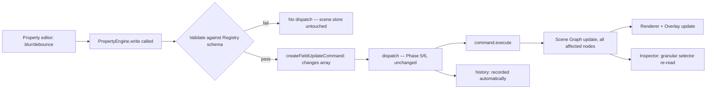

# PHASE 7 — Inspector, Property Engine & Style Properties (Enhanced)

## Role

Principal Software Architect / Senior React-TypeScript Engineer / Performance Engineer, continuing the same engine.

## Required Reading Before You Start

- `docs/ARCHITECTURE.md` §7.1 (`inspector.store` was reserved there from the very first draft of this document — this phase is where it finally gets built), §9.14 (Style System — **read this carefully before Step 1**, it's not what this phase's original brief means by the same name), §9.15 (Property/Inspector spec).
- `docs/PHASE-1-SUMMARY.md` — reuse the Validation System's Zod patterns for property validation.
- `docs/PHASE-4-SUMMARY.md` / `docs/PHASE-5-SUMMARY.md` — `selectedIds` has been array-shaped and multi-select-capable since Phase 4; Phase 5 actually brought multi-select in via Selecto. This phase is the first one that has to actually deal with it.
- `docs/PHASE-6-SUMMARY.md` — `createFieldUpdateCommand` already exists. This phase generalizes its signature, doesn't replace it.

## Hard Constraints

Same as prior phases. Plus the one this phase states itself: the Inspector never touches the Scene Graph directly — every write goes through Property Engine → `dispatch()`.

## Explicit Out of Scope for Phase 7

Auto Layout, Components, Variables, Animation, Asset Manager, Responsive Engine.

**Variables being out of scope is why Step 1 below matters** — `ARCHITECTURE.md`'s actual Style System depends on the Variable System and can't be meaningfully built until it exists.

---

## Step 0 — Architecture Audit (Gate — do not skip)

1. Analyze current property editing, existing forms, existing style-update code, existing inspector structure.
2. Identify duplicated property logic, inline style mutations, duplicated validation.
3. Produce **`docs/PHASE-7-AUDIT.md`**.
4. **Stop and wait for explicit confirmation before Step 1.**

---

## Step 1 — Style Properties, Not "Style System"

**This is the headline correction.** `ARCHITECTURE.md` §9.14 already defines a Style System: `resolveStyle(node): ResolvedStyle`, owning cascading/resolution, depending on the Variable System. That's a *read* system for the Renderer to consume. What this phase's original brief actually describes — Inspector edits writing width/color/typography/etc. to the Scene Graph — is a *write* concern, and it doesn't need Variables at all.

Building a "Style System" now, under that name, in that folder, creates a real problem for later: whoever eventually builds the actual §9.14 resolution system either collides with this one or has to explain why two things share a name and do different jobs.

**Fix:** everything in the original brief's Step 4 list (Width, Height, Padding, Background, Typography, Shadow, Z-Index, etc.) is registered as an ordinary **property group** in the Property Registry (Step 2) and read/written through the Property Engine (Step 3) — the exact same pipeline as any other property, no special system. Reserve the name "Style System" and its eventual folder for when Variables actually exist and cascading resolution is a real, buildable thing — at that point, what this phase writes to `node.style` becomes the *input* the real Style System resolves, not something it replaces.

Two items from the original list need their own call-out:
- **"Custom CSS"** — fine to register as a plain string property if you want the field to exist, but don't build real CSS parsing/sanitization/application this phase; there's no scoping strategy defined yet and no reason to invent one now.
- **"CSS Variables"** — this is not a smaller version of anything; it's literally the future Variable System's actual job (`ARCHITECTURE.md` §10 #38). Don't build a parallel variable-binding mechanism. Defer entirely.
- "Transitions" (a static `transition-duration`/`easing` value) is fine as an ordinary property — unlike "Future Animations," it doesn't need the Timeline/Animation System's infrastructure to just hold a value.

---

## Step 2 — Property Registry

**Kept as its own module, not merged into Property Engine — this is deliberate, and different from how prior phases resolved the same-shaped naming issue.** The test that's been applied consistently since Phase 2: *is there an immediate, current-phase lookup keyed by a string only known at runtime?* Renderer Registry (Phase 2): yes — `type → component`, every render. Command Registry (Phase 6): no — every command is called by name, known at compile time; it was cut. Property Registry: **yes** — Inspector needs `elementType → property schema` for whatever type the user happens to have selected, unknowable until runtime. Same test, same answer as Renderer Registry: keep it as its own module.

The original brief's actual mistake wasn't proposing two systems — it's that "Property Registration" appears as a responsibility of *both* Step 3 (Property Engine) and Step 5 (Property Registry). Registration lives here, once; Property Engine queries it, doesn't reimplement it.

```ts
interface PropertySchema {
  key: string;                    // e.g. 'style.color', 'transform.width'
  group: 'dimensions' | 'position' | 'typography' | 'fill' | 'border' | 'effects' | string;
  editor: 'number' | 'slider' | 'select' | 'colorPicker' | 'checkbox' | 'switch' | string;
  defaultValue: unknown;
  validate: (value: unknown) => boolean;        // built on Phase 1's Zod patterns
  appliesTo?: (node: SceneNode) => boolean;      // e.g. grid-only fields — "Property Visibility"
}

interface PropertyRegistryAPI {
  register(elementType: ElementType | 'shared', schema: PropertySchema): void;
  getSchemasFor(elementType: ElementType): PropertySchema[];
  getSchema(elementType: ElementType, key: string): PropertySchema | undefined;
}
```

**Folder:** `document/properties/registry.ts`

---

## Step 3 — Property Engine

Runtime read/write/validate, nothing more.

```ts
interface PropertyEngineAPI {
  read(nodeId: NodeId, key: string): unknown;
  write(nodeIds: NodeId[], key: string, value: unknown): void;
}
```

- `write` validates against the Registry's schema for that key **before** dispatching — an invalid value must not reach `dispatch()` at all, and `scene.store` must remain unchanged if validation fails.
- `write` always accepts an array of node ids, even for a single selection — see Step 4 for why.
- **Property Engine calls `dispatch()` (Phase 5/6) directly — it doesn't call History, and doesn't need to know it exists.** This is the third phase in a row (Transform, Clipboard/Keyboard, now Property) where the answer to "how does this get undo support" is "call the same `dispatch()` everyone else does."

**Folder:** `document/properties/engine.ts`

---

## Step 4 — Multi-Selection (Missing From the Original Brief Entirely)

Phase 5 brought in multi-select via Selecto. Nothing in the original Phase 7 brief says what happens when three nodes are selected and you change the width. Two separable decisions:

**Write side — not optional, do this now, it's cheap.** Generalize Phase 6's `createFieldUpdateCommand` from a single `nodeId` to an array of per-node changes, matching the shape `createTransformCommand` already uses:

```ts
function createFieldUpdateCommand(
  field: string,
  changes: Array<{ nodeId: NodeId; before: unknown; after: unknown }>
): Command
```

This does touch Phase 6's existing factory signature — a single-node call just becomes a one-element array, but it's worth flagging honestly as a change to existing code, not purely additive. Without this, editing a property across a multi-selection either can't work at all, or produces N separate Commands for one user-perceived edit — meaning undo would need N presses to reverse one change.

**Read side — a real design decision, not a silent default.** When selected nodes disagree on a property's value, do you show the active node's value only (simplest, matches what the original brief implicitly assumes), or compute a mixed/blank state per property (what Figma and Canva actually do, and genuinely better UX for multi-select)? The second is more work — a `readMixed()` variant and Inspector UI to render the mixed state — and the original brief's own Verification section only describes single-selection editing, so it's reasonable to ship the simpler version now and upgrade later without an architecture change:

```ts
readMixed(nodeIds: NodeId[], key: string): { value: unknown; mixed: boolean };
```

Pick one and say so in `PHASE-7-SUMMARY.md` — don't let this get decided implicitly by whichever code path happens to get written first.

---

## Step 5 — Inspector System

Presentation only, exactly as the original brief states — no correction needed to that principle, just to what it's built on:

- Reads from `selection.store` (which node(s)), `scene.store` (their data, via `PropertyEngine.read`/`readMixed`), and the Property Registry (what to render, for the selected type).
- Writes nothing directly — every change goes through `PropertyEngine.write()`.

**`inspector.store`** — this is the store `ARCHITECTURE.md` §7.1 reserved from its very first draft: *"Active inspector tab/UI state (not node data)."* Purely presentational (which section is expanded, which tab is active) — never node data.

```ts
interface InspectorStoreState {
  expandedGroups: string[];
  activeTab: string | null;
}
```

**Folder:** `document/inspector/`

---

## Step 6 — Property Editors

Reusable input components (Number, Slider, Select, ColorPicker, etc.) — presentational, live under Inspector's domain.

**Commit on blur or debounce, never on every keystroke.** This is the direct parallel to Phase 5's live-preview-vs-commit split: typing "480" one character at a time shouldn't create three undo-stack entries for "4", "48", "480". Each editor holds its own **local `useState` draft value** while typing (same treatment as Phase 5's Moveable adapter's local drag state — nothing else in the app needs to reactively know about an uncommitted keystroke) and calls `PropertyEngine.write()` only on blur or after a debounce window.

**No Property Store, no Style Store.** A property's current *committed* value is just `scene.store` data — there's nothing independent to hold. Draft/uncommitted values are local component state, not global. Style properties, per Step 1, are ordinary properties with no separate storage layer of their own.

**Folder:** `document/inspector/editors/`

---

## Step 7 — Event Flow



For a multi-selection edit, `SG` fans out to every node in the `changes` array as one Command — one undo step covers all of them.

---

## Step 8 — Performance

Same granular-selector discipline as every prior phase, not a new mechanism: each Property Editor subscribes to only its own property's value via a selector (`useSceneStore(s => s.nodes[nodeId]?.style.color)`), not the whole node object. Editing one field shouldn't re-render sibling fields or unrelated inspector sections — this is the same thing that's kept Renderer, Overlay, and Transform updates cheap since Phase 2, applied here.

---

## Step 9 — Stores

- **`inspector.store`** — kept, and it's the one `ARCHITECTURE.md` §7.1 already reserved.
- **No Property Store** — property values live in `scene.store`; nothing independent to hold.
- **No Style Store** — folded into the Step 1 reframing; style properties have no separate storage layer.

---

## Step 10 — Folder Structure

```
src/
└── document/
    ├── properties/
    │   ├── engine.ts       # Property Engine
    │   ├── registry.ts     # Property Registry
    │   └── groups/
    │       └── style.ts    # style property-group registration — data, not a system
    └── inspector/
        ├── Inspector.tsx
        └── editors/         # Number, Slider, Select, ColorPicker, etc.
```

`document/properties/` and `document/inspector/` are the folders `ARCHITECTURE.md` §6 reserved in its very first draft, following `engine/command/` (Phase 5) and `engine/history/` (Phase 6) — this is the third pair of reserved folders in the series now actually filled in. No separate `property-registry/`, `property-editors/`, `validators/`, or `style/` top-level folders.

---

## Step 11 — Verification Gate

- [ ] `npm run test` green, including:
  - Registry: registering and looking up a schema; unknown element type falls back gracefully (same fallback-pattern precedent as Renderer Registry, Phase 2).
  - Engine: `read` returns the correct current value; `write` with an invalid value dispatches nothing and leaves `scene.store` unchanged; `write` across a multi-selection dispatches exactly one Command covering all affected nodes.
  - Debounce/commit behavior: rapid keystrokes in a Number editor produce one dispatched Command on blur, not one per keystroke.
  - Architecture-conformance check: Inspector code never calls `sceneGraph.updateNode` or any Scene Graph mutation directly — only `PropertyEngine.write()`.
  - Render-count check: editing one property field doesn't re-render sibling fields or unrelated Inspector sections.
- [ ] `npm run lint` passes
- [ ] `npm run build` succeeds
- [ ] `npm run dev` — manual smoke test: select → inspector populates → change width → object updates → undo → redo, exactly as the original brief's Verification section describes; also test with a multi-selection
- [ ] No existing feature regressed

---

## Deliverables Checklist

- [ ] `docs/PHASE-7-AUDIT.md` (reviewed/approved before proceeding)
- [ ] Property Registry (`document/properties/registry.ts`) with style properties registered as an ordinary group
- [ ] Property Engine (`document/properties/engine.ts`) — read, write (validated, multi-node-capable), calling existing `dispatch()`
- [ ] `createFieldUpdateCommand` generalized to accept an array of per-node changes
- [ ] Inspector System (`document/inspector/`) — presentation only, `inspector.store` for UI-only state
- [ ] Property Editors with commit-on-blur/debounce and local draft state
- [ ] Decision recorded on mixed-value multi-select display (chosen now, or explicitly deferred)
- [ ] All Step 11 checks passing
- [ ] `docs/PHASE-7-SUMMARY.md` — confirm the multi-select read decision, and flag that this phase's `node.style` writes are exactly what the real §9.14 Style System will read once Variables exist

## Corrections Recap

1. **Headline:** "Style System" renamed to "Style Properties" — an ordinary property group, not the resolution system `ARCHITECTURE.md` §9.14 already reserves that name for, which depends on the not-yet-built Variable System.
2. Property Engine + Property Registry kept separate (unlike Command Registry, which was cut in Phase 6) — same runtime-lookup test, consistently applied, different verdict because the situations differ.
3. Multi-selection support added for the write path (generalized, array-shaped Command) since it was entirely unaddressed despite existing since Phase 5; the read-side "mixed value" UX flagged as an explicit decision rather than a silent assumption.
4. No Property Store, no Style Store — neither has independent state beyond what `scene.store` and the Registry already hold.
5. `inspector.store` kept — it's the store reserved in `ARCHITECTURE.md` §7.1 since the first draft.
6. Draft/uncommitted property values while typing are local component state, mirroring Phase 5's local drag state, not a store.
7. Property Editors commit on blur/debounce, not per keystroke — direct parallel to Phase 5's live-preview-vs-commit split.
8. "Custom CSS" and "CSS Variables" flagged as premature; the latter is explicitly deferred to the actual Variable System.
9. Property Engine calls the existing `dispatch()` directly, with no new History wiring needed — third phase running where this seam pays off unmodified.
10. Validation reuses Phase 1's Zod-based Validation System rather than a parallel mechanism.
11. Folder placement confirmed against `ARCHITECTURE.md` §6's reserved layout.

## Recommendation for Phase 8

Per the roadmap in `ARCHITECTURE.md` §13, the two reasonable next candidates are the Variable System and the Asset Manager. Variables are worth prioritizing if feasible — they unblock two things at once: the *real* Style System (§9.14, finally buildable once Variables exist, consuming exactly what this phase wrote to `node.style` as its input) and Components (which need variable binding for reusable instances). Whichever comes first, note in that phase's audit that Style Properties (this phase) becomes an input to Style System (future), not something it replaces.

## Stop Condition

Do not implement Auto Layout, Components, Variables, Animation, Asset Manager, or Responsive. If Property Editors seem to want a Variable-bound value, note it in `PHASE-7-SUMMARY.md` as a dependency for whichever phase builds the Variable System.
